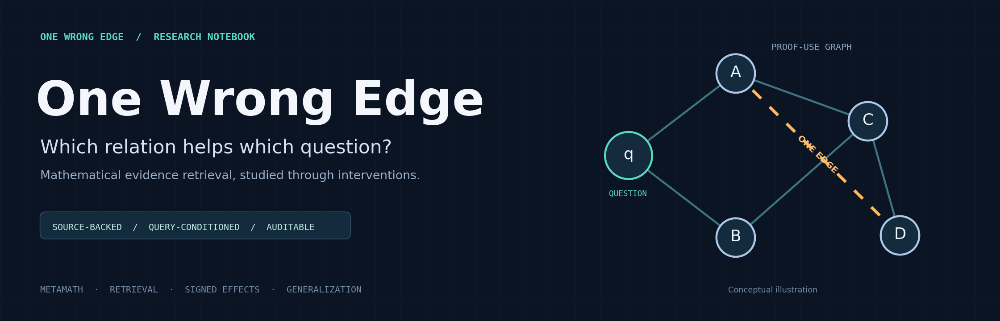
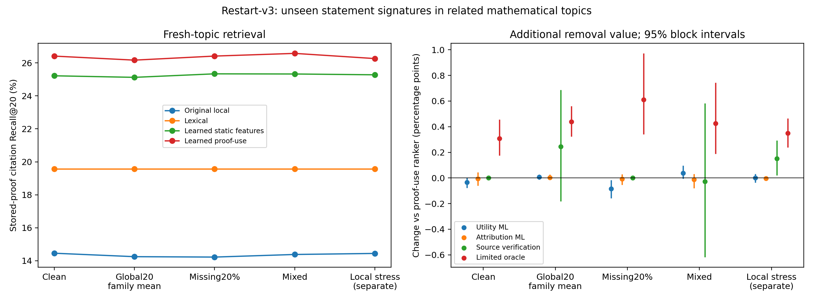
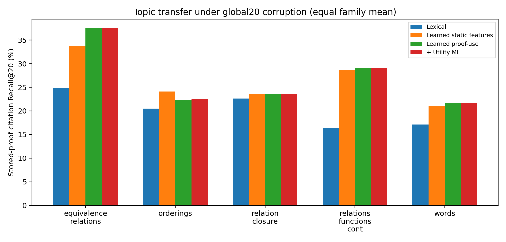
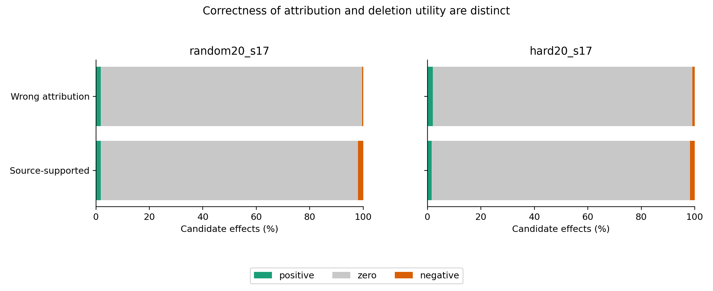
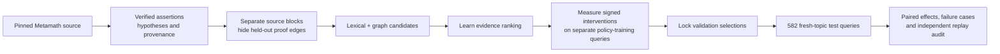

<div align="center">



### 수학 지식그래프의 어떤 연결이, 어떤 질문을 돕거나 방해할까?

**Question-conditioned interventions for mathematical evidence retrieval**

[](https://github.com/gjtjwns06-ui/one-wrong-edge/actions/workflows/research-checks.yml)


[](study/data/raw/LICENSE)
[](study/RESTART_V3_PROTOCOL.md)

[**결과 보고서**](study/RESULTS_V3.md) · [**영문 논문 초안**](study/One_Wrong_Edge_Paper_Draft_Restart_v3.md) · [**실험 설계**](study/RESTART_V3_PROTOCOL.md) · [**재현하기**](docs/REPRODUCING.md) · [**전체 자료 다운로드**](https://github.com/gjtjwns06-ui/one-wrong-edge/releases/tag/v0.3.0)

</div>

---

## The question

수학 문헌의 정리·가정·증명은 서로 연결돼 있습니다. 하지만 어떤 관계가 원문에 맞는지와, 그 관계가 **지금 이 질문의 근거 검색에 도움이 되는지**는 서로 다른 문제입니다.

**One Wrong Edge**는 관계를 추가·누락·억제하기 전후의 검색 결과를 직접 비교합니다. 효과가 좋아진 경우, 나빠진 경우, 아무 변화가 없는 경우를 모두 보존하고, 질문과 그래프 특징으로 그 효과를 예측할 수 있는지 실험합니다.

$$\Delta(q,e)=U(q,G\setminus\{e\})-U(q,G)$$

여기서 $U$는 한 저장 증명에 대한 직접 인용 회수 점수입니다. 양의 $\Delta$는 해당 검색 조건에서 간선 억제가 도움이 됐다는 뜻입니다. 간선의 수학적 필수성이나 새로운 증명의 성공을 의미하지는 않습니다.

## At a glance

| 연구 대상 | 최신 실행 `restart-v3` |
| :--- | :--- |
| **색인** | 핵심 정리 **4,643개** + 원문 인용 경계 문서 **2,223개** = **6,866개** |
| **관계** | 공개된 배경 증명에서 읽은 인용 관계 **29,862개** |
| **새 주제 시험** | 이전 색인에 같은 canonical signature가 없던 **582개 질문**, **38개 원문 블록** |
| **학습 분리** | 순위 학습 **2,306** / 정책 학습 **735** / 검증 **639** / 시험 **582** |
| **평가** | 정상·관계 추가·누락·혼합·국소 스트레스, 출력 예산 **10 / 20 / 40** |
| **근거 추적** | 고정된 원문 커밋, 가정·변수 제약 보존, 질문별 순위와 개입 기록, 재실행 감사 |

원문은 [Metamath set.mm](https://github.com/metamath/set.mm)입니다. 전체 원문을 파싱·검증했으며, **주 검색 실험은 집합·관계·함수와 그래프 이론의 관련 범위**를 사용했습니다. 167,616개 정책 측정행은 반복 측정이며 독립 질문 수가 아닙니다. [자료·분리 설명 →](study/RESULTS_V3.md#자료와-분리)

## What we found

| 최신 시험 결과 | 측정값 | 읽는 방법 |
| :--- | ---: | :--- |
| 정상 조건의 증명 인용 학습 검색 | **26.41%** Recall@20 | 전역 어휘 검색 **19.56%**, 기존 지역 검색 **14.46%**와 비교 |
| 정상 조건: 학습 검색 − 어휘 검색 | **+6.848pp** [3.438, 9.869] | 질문별 짝지은 차이, 95% 원문 블록 부트스트랩 구간 |
| 전역 20% 오류 평균: 효용 ML의 추가 효과 | **+0.006pp** [−0.012, +0.028] | **추가 개선을 확정하지 못함** |

같은 출력 상한을 사용해도 검색 시간·후보 구성·반환 토큰 비용이 같아지지는 않습니다. 평가 대상은 형식 질문의 **저장된 증명 인용 회수**이며, 자연어 답변 정확도와 새 증명 생성 성공률은 측정하지 않았습니다. `pp`는 퍼센트포인트입니다. [전체 비교와 한계 →](study/RESULTS_V3.md)

### 01 · Retrieval and intervention value



왼쪽은 검색 방법별 인용 Recall@20, 오른쪽은 고정된 주 검색기 위에서 간선 억제가 더한 효과입니다. **검색기 개선과 간선 개입의 추가 효과를 구분**해서 읽습니다. 오라클은 실제 효과를 미리 아는 제한된 상한 비교군입니다.

[원본 SVG](study/runs/restart_v3/figures/restart_stages.svg) · [집계값](study/runs/restart_v3/summary.csv) · [짝지은 차이와 구간](study/runs/restart_v3/comparisons.csv)

### 02 · Transfer across related mathematical topics



동치관계·순서·관계 폐포·관계/함수 후속 단원·문자열에서 성능이 다르게 나타났습니다. 이 시험은 새 정리 서명을 사용하지만, 같은 수학 라이브러리 안의 의미적 유사성까지 제거한 독립 출처 전이 실험은 아닙니다.

[원본 SVG](study/runs/restart_v3/figures/topic_transfer.svg) · [주제별 결과](study/runs/restart_v3/topic_summary.csv)

<details>
<summary><strong>연구의 출발점 · 관계의 정확성과 검색 효용이 다른 이유</strong></summary>



위 그림은 **이전 `scoped-v1` 연구**입니다. 출처가 맞는 관계와 잘못 귀속된 관계 모두에서 삭제 효과가 단순한 이분법으로 나뉘지 않음을 보여줍니다. v1과 v3는 질문·분할·검색기가 다르므로 수치를 같은 시험의 전후 변화로 비교하지 않습니다. [초기 결과와 해석](study/RESULTS.md)

</details>

## How the experiment works



**출처 정확성**은 고정된 원문 증명에 그 인용 관계가 있는지를 뜻합니다. **질문별 효용**은 관계를 억제했을 때 검색 점수가 어떻게 달라지는지입니다. 새로 주입한 간선은 잘못된 *증명 사용 귀속*이며, 곧바로 거짓 수학 명제가 되는 것은 아닙니다.

모델 입력에는 시험 정답, 사후 개입 효과, 주입 간선 표시를 넣지 않습니다. 색인 밖 정답도 평가 분모에 남기며, 순위 학습과 정책 학습 질문을 분리합니다. [프로토콜](study/RESTART_V3_PROTOCOL.md) · [검사 기록](study/DELIVERY_CHECKS_V3.json) · [전체 감사](study/runs/restart_v3/audit.json)

## Explore the research

| 읽고 싶은 내용 | 바로 가기 |
| :--- | :--- |
| 최신 결과·불확실성·실패 분석 | [RESULTS_V3.md](study/RESULTS_V3.md) |
| 결과를 반영한 영문 논문 초안 | [Restart-v3 manuscript](study/One_Wrong_Edge_Paper_Draft_Restart_v3.md) |
| 시험 전에 고정한 설계 | [Restart-v3 protocol](study/RESTART_V3_PROTOCOL.md) |
| 선행연구와 기여의 경계 | [Literature review](study/LITERATURE_V3.md) |
| 실행 코드 | [owe/](study/owe) · [tests/](study/tests) · [configs/](study/configs) |
| 실제 사례와 잃거나 얻은 근거 | [Worked examples](study/runs/restart_v3/failure_and_worked_examples.json) |
| 이전 실험과 설계 변화 | [v1](study/README.md) · [v2](study/README_V2.md) · [v3](study/README_V3.md) |
| 파일 해시·출처와 그래프 원본 | [Publication manifest](PUBLICATION.json) · [Notices](NOTICE.md) |

## Reproduce it

Git에는 코드·논문·설계·그래프와 작은 결과표를 담았습니다. **전체 모델·원시 측정·원문·중간 데이터는 [v0.3.0 Release](https://github.com/gjtjwns06-ui/one-wrong-edge/releases/tag/v0.3.0)의 원본 ZIP**으로 제공합니다. 저장소의 `study/` 경로는 그 ZIP의 원래 파일 구조를 유지해 기존 해시 감사가 그대로 동작합니다.

```bash
git clone https://github.com/gjtjwns06-ui/one-wrong-edge.git
cd one-wrong-edge
python scripts/restore_artifacts.py
python -m venv .venv
# 가상환경 활성화 후:
python -m pip install -r study/requirements_v2.txt
cd study
python -m pytest -q tests
python -m owe.restart_v3 infer --qid trrelssd --condition clean
```

`restore_artifacts.py`는 약 **153MB**의 고정된 Release 자료를 내려받아 SHA-256을 검증하고 누락 파일을 복원합니다. 이미 수정된 연구 파일이 있으면 덮어쓰지 않고 중단합니다. 전체 재실행, 원시 결과 감사, OS별 명령어는 [재현 가이드](docs/REPRODUCING.md)를 참고하세요.

## Research status

현재 공개본은 **2026-11-25에 완료한 `restart-v3` 실험의 연구 스냅샷**입니다. 확인한 결과와 부정적 결과를 함께 공개합니다. 학습 기반 간선 제거가 일반적으로 우월하다는 주장, 모든 수학 분야로의 일반화, 생성형 답변·증명 품질 향상은 현재 결과의 주장 범위에 포함하지 않습니다.

후속 과제는 독립 검수 자연어 질문, 대체 증명 근거 평가, 실제 논리 오류와 출처 귀속 오류의 분리, 별도 코퍼스 전이 및 답변·증명 성공률 검증입니다.

---

<div align="center">

**Inspect the source. Measure the effect. Keep the failures.**

[Results](study/RESULTS_V3.md) · [Manuscript](study/One_Wrong_Edge_Paper_Draft_Restart_v3.md) · [Reproduction](docs/REPRODUCING.md) · [Release](https://github.com/gjtjwns06-ui/one-wrong-edge/releases/tag/v0.3.0)

</div>
