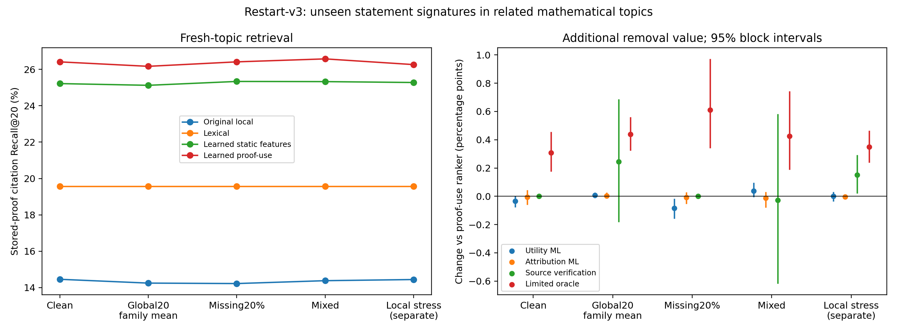
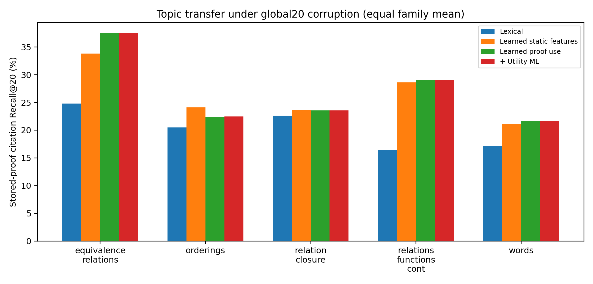

# One Wrong Edge on Fresh Mathematical Topics

## Rebuilding premise retrieval and measuring the additional value of edge removal

25 November 2026 · Empirical working draft 0.4 · restart-v3

## Abstract

We rebuild a scoped Metamath retrieval experiment from its pinned raw source and evaluate related topics whose canonical statement signatures were absent from all previously indexed documents. The new test comprises 582 questions in 38 source blocks. Earlier subject material is repartitioned into disjoint ranker-training, policy-training and validation blocks. Candidate generation and proof-use ranking are frozen before a separate policy-training set supplies newly rerun signed removal effects. Clean stored-proof citation Recall@20 is 0.2641. On the prespecified equal-family mean of random and lexical-hard global corruption, additional utility learning changes Recall@20 by +0.006 percentage points, with a 95% source-block bootstrap interval [-0.012, +0.028]pp. The prespecified global-corruption mean did not establish additional utility-policy improvement. We distinguish source-attribution accuracy from retrieval utility and keep traversal-local stress separate from global corruption. These are new-topic results within one previously parsed formal library, not a new-source or natural-language reasoning benchmark.

## 1. Motivation and contribution

The previous development evaluation found both candidate exclusion and lexical ranking loss. It also showed that accurate detection of false proof-use attributions need not improve retrieval. This restart tests those findings on additional related topics, rather than treating a new random split of previously inspected questions as independent confirmation. Learned premise ranking, graph expansion and query-conditioned decisions are established ideas. The contribution sought here is reproducible sequential evidence about candidate availability, actual stored-proof citation ranking, removal headroom and the gap between attribution correctness and query utility. No superiority over named external retrieval or theorem-proving systems is claimed.

## 2. Source, scope and heldout semantics

The pinned source is [Metamath set.mm](https://github.com/metamath/set.mm/tree/7d1aa054166171211aa5c3f5e497024031bdbd27), with the original source licence and checksum retained. The full raw parse/check is source quality assurance; the retrieval graph is restricted to a related subject allowlist and terminal supporting documents. The scope contains 4,643 core assertions, 2,223 boundary documents and 29,862 searchable public proof-use edges. It covers elementary sets, relations, functions and finite sets; graph walks/paths/Eulerian paths; and additional words, relation closures, equivalence relations, orderings and relation/function material.

Gold consists of actual direct `|-` citations in one checked proof. It is not the set of premises necessary in every proof, and alternative sufficient proofs are not exhaustively annotated. Documents preserve essential hypotheses and distinct-variable constraints. The test excludes any canonical signature previously present even as an indexed boundary document; this is stricter than excluding old questions alone. Nevertheless, canonical novelty does not establish semantic independence from related lemmas, and the raw library was previously parsed for source verification. Old development material is reused with a new block assignment. This is topic-transfer evaluation within one source.

All fresh-topic proof-source edges are withheld, not only edges from selected test questions. The retriever rejects the query, equivalent signatures and later-source candidates. Historical citation features use only observable source references preceding the query. The test has 9,752 annotated direct citations, of which 9,155 are indexed; mean per-question indexed availability is 94.91%. The index contains preselected core-topic documents and one-hop boundaries derived only from public proofs. Heldout proof dependencies do not expand the index; unindexed gold stays in recall denominators.

## 3. Sequential procedure and controls

First, candidate generation combines lexical anchors, expandable lexical seeds and public historical-citation priors. Validation chooses the candidate variant. Second, supervised ranking predicts actual training-proof citations; a static-feature learned ablation excludes ten observed-graph feature columns but retains source-order distance, axiom/definition/boundary roles, hypothesis/distinct-variable counts and formal-text features. This reranker uses the same graph-generated candidates, so it is neither a pure-formula-only comparator nor a graph-free end-to-end retriever. Expanded-pool lexical ranking, historical local retrieval, global lexical retrieval and a smaller64-candidate condition serve as controls. The old-local algorithm is rerun using the new common index, publicly fitted IDF, sublinear TF and corruption graphs; previous saved scores are not reused. Earlier v2 scores on different questions/indexing are not direct causal comparators. Query/premise identity embeddings, gold, corruption flags, heldout proof references and clean/observed graph differences are excluded from prediction features.

Validation selected `boost_31` as the primary proof-use predictor, with a separately fitted graph-feature-excluded/static-feature model evaluated on the same candidates.

Third, the selected ranker is frozen. A separate policy-training partition, whose questions supplied no ranker labels, supplies signed removal effects by rerunning candidates, graph features and ranking after intervention. This avoids both reusing the prior experiment's effects and shifting from an out-of-fold training ranker to a different final ranker. Utility regression and false-attribution classification are distinguished. Thresholds, action budgets and abstention are selected on validation before test evaluation.

Matched-count random deletion uses the same allowable action pool. Source verification has stronger provenance access and is not a lightweight action-budget-matched learner. The single-deletion oracle observes actual effects inside a limited candidate action set; it diagnoses headroom and is not attainable predictor performance. Validation evaluates budgets1/3/8 by actually rerunning multi-edge outcomes rather than adding single-edge effects. Test evaluation and deployment replays concern the selected policies below; they do not validate deployment of unselected multi-edge policies.

| Policy | Model | Selected max deletions | Threshold | Validation delta (pp) |
| --- | --- | --- | --- | --- |
| utility | utility_boost | 1 | 0.002 | +0.0229 |
| wrongness | wrongness_boost | 1 | 0.8 | +0.0190 |

## 4. Corruption and statistical evaluation

Random and lexical-hard global additions, missing references, a mixed removal/addition condition and a separate traversal-local stress are fixed in advance. False additions mean unsupported proof-use attribution, not false mathematical propositions. Source order and admissible relation endpoints are preserved; actual injection and exposure counts are recorded. Training, validation and test corruption seeds are distinct. New seeds test within-mechanism generalization, while untrained missing/mixed mechanisms provide error-distribution shifts.

The primary incremental comparison is utility policy versus no deletion on the frozen proof-use retriever at K=20. Repeated random seeds and repeated hard seeds are each averaged within query; the two family means then receive equal weight. Clean, missing, mixed and local stress are reported separately. Local stress chooses injection sites deterministically from observable baseline traversal and formula similarity without gold or realized retrieval losses, and includes questions where injection is unavailable. The439 suffix is a condition label, not an RNG seed or independent random repetition. It is a conditional mechanism diagnostic rather than a representative population error model.

We report macro citation Recall, nDCG, full citation recovery, candidate availability/ceiling, K=10/40, action/harm/purity rates, topic transfer and costs. Paired 95% intervals resample source blocks 2,000 times after within-query seed averaging. Intervals are descriptive and conditional on the fixed selected models. They neither cover all training uncertainty nor provide multiplicity-adjusted confirmatory guarantees. Small topic-specific block counts further limit interpretation.

## 5. Results

Values below are macro direct-citation Recall@20 percentages.

| Condition | Old local | Lexical | Static-feature ranker | Proof-use ranker | + Utility | + Attribution |
| --- | --- | --- | --- | --- | --- | --- |
| Clean | 14.46 | 19.56 | 25.22 | 26.41 | 26.38 | 26.41 |
| Random +20% | 14.35 | 19.56 | 25.12 | 26.32 | 26.31 | 26.31 |
| Lexical-hard +20% | 14.14 | 19.56 | 25.13 | 26.02 | 26.04 | 26.03 |
| Global20 family mean | 14.25 | 19.56 | 25.12 | 26.17 | 26.17 | 26.17 |
| Missing20% | 14.22 | 19.56 | 25.34 | 26.41 | 26.33 | 26.41 |
| Mixed | 14.38 | 19.56 | 25.33 | 26.58 | 26.62 | 26.57 |
| Local exposure stress | 14.44 | 19.56 | 25.28 | 26.26 | 26.26 | 26.26 |

Corruption itself is also paired against the same question's clean result under the frozen no-deletion retriever. Negative changes indicate harm and positive changes indicate improvement; damage is measured rather than assumed. Event rates are formed per raw seed before averaging.

| Condition | Corrupted minus clean (pp) | Corruption harmed (%) | False-edge traversal exposure (%) |
| --- | --- | --- | --- |
| Random +20% | -0.097 [-0.509, +0.279] | 10.14 | 92.18 |
| Lexical-hard +20% | -0.392 [-0.956, +0.184] | 17.18 | 92.27 |
| Global20 family mean | -0.245 [-0.686, +0.182] | 13.66 | 92.23 |
| Missing20% | +0.001 [-0.505, +0.528] | 12.71 | 0.00 |
| Mixed | +0.164 [-0.323, +0.668] | 13.92 | 90.03 |
| Local exposure stress | -0.150 [-0.292, -0.021] | 4.47 | 92.78 |

Additional changes relative to the same frozen proof-use retriever are in percentage points.

| Condition | Utility delta (pp) | Attribution delta (pp) | Source-verification delta (pp) | Limited single-removal oracle (pp) |
| --- | --- | --- | --- | --- |
| Clean | -0.033 [-0.078, +0.000] | -0.006 [-0.059, +0.044] | +0.000 [+0.000, +0.000] | +0.307 [+0.174, +0.456] |
| Random +20% | -0.009 [-0.040, +0.021] | -0.003 [-0.026, +0.020] | +0.097 [-0.279, +0.509] | +0.395 [+0.242, +0.567] |
| Lexical-hard +20% | +0.021 [-0.014, +0.065] | +0.010 [-0.019, +0.043] | +0.392 [-0.184, +0.956] | +0.481 [+0.310, +0.687] |
| Global20 family mean | +0.006 [-0.012, +0.028] | +0.004 [-0.014, +0.026] | +0.245 [-0.182, +0.686] | +0.438 [+0.324, +0.560] |
| Missing20% | -0.084 [-0.157, -0.016] | -0.007 [-0.054, +0.030] | +0.000 [+0.000, +0.000] | +0.611 [+0.341, +0.972] |
| Mixed | +0.039 [-0.005, +0.096] | -0.011 [-0.080, +0.032] | -0.028 [-0.617, +0.583] | +0.425 [+0.188, +0.744] |
| Local exposure stress | -0.000 [-0.035, +0.030] | -0.004 [-0.012, +0.000] | +0.150 [+0.021, +0.292] | +0.349 [+0.239, +0.466] |

The utility policy's primary change is +0.006 [-0.012, +0.028]pp. The attribution classifier's primary change is +0.004 [-0.014, +0.026]pp. Accuracy among deleted attributions and signed retrieval benefit are different outcomes, so a high deletion purity alone is not evidence of better retrieval. Observable exposure strata use each raw query-seed traversal's presence/absence of any false edge, then average effect numerators and exposure weights within query/family before taking their ratio. Thus strata do not use a union-over-seeds question subset or gold-dependent selection, and source blocks remain the resampling units. A no-false-traversal episode can still have contaminated global citation priors, so this stratification does not identify a causal exposure effect. On clean questions, the proof-use ranker improves 405 questions, harms 46 and ties 131 versus the original local retriever. Actual lost/gained citations and suppressed edges are preserved in the worked-example artifact, including adverse cases.

Against matched-count random deletion, the utility policy changes global20 recall by +0.015 [-0.008, +0.043]pp and the attribution policy by +0.021 [-0.007, +0.053]pp; neither interval establishes an advantage. The utility policy's missing-edge change is -0.084 [-0.157, -0.016]pp, illustrating adverse distribution transfer among the descriptive secondary comparisons.

Topic results below use the equal-family global20 mean.

| Topic | Questions | Blocks | Lexical Recall | Proof-use Recall | Utility delta (pp) |
| --- | --- | --- | --- | --- | --- |
| equivalence_relations | 121 | 5 | 24.82 | 37.54 | -0.005 [-0.016, +0.000] |
| orderings | 26 | 2 | 20.48 | 22.31 | +0.160 [+0.000, +0.245] |
| relation_closure | 83 | 7 | 22.64 | 23.56 | +0.000 [+0.000, +0.000] |
| relations_functions_cont | 70 | 3 | 16.40 | 29.13 | +0.013 [+0.000, +0.040] |
| words | 282 | 21 | 17.11 | 21.68 | -0.003 [-0.029, +0.025] |

## 6. Mechanism, costs and limitations

The candidate ceiling separates unavailable evidence from within-pool ranking loss. The limited removal oracle and signed effect distribution separate predictor failure from a near-zero controllable effect. A result concentrated in local exposure stress cannot establish average utility under global corruption. Source verification can remove many false attributions using exact public proof provenance, whereas the learned policy operates with observable features and bounded actions. Those input and action differences constrain cost-effectiveness claims.

Clean gold mass is partitioned into retrieved citations, unindexed citations, indexed but ineligible citations, eligible citations outside the candidate pool, unavoidable K20 capacity loss within the pool, and avoidable within-pool ranking loss. These components are disjoint and sum to one per query. This distinguishes coverage limits from ranking limits without attributing every failure to graph quality. Per-topic query unigram OOV fractions against the publicly fitted vocabulary are descriptive diagnostics, not causal proof that OOV causes retrieval failure.

In particular, 40.10% of clean gold mass is eligible but outside the pool and 28.10% is avoidable within-pool ranking loss. Clean proof-use ranking exceeds static-feature ranking by +1.194 [+0.236, +2.164]pp. Increasing the frozen-model recipe from64 to256 candidates changes clean recall by -0.080 [-1.137, +0.914]pp, so larger candidate sets are not automatically justified. Global corruption changes no-deletion recall by -0.245 [-0.686, +0.182]pp even though 92.23% of query-seed episodes traverse at least one false edge. The weak incremental policy result therefore cannot be explained simply by absent error exposure. The local-stress attribution AUC is 0.332, which also cautions against transferring the global error classifier to that deterministic local mechanism.

Raw `offline_seconds` measures counterfactual effect-label construction per query/context, not production inference latency. It is repeated across method and K rows and must not be summed across those duplicates. Direct lexical, old-local, smaller64 and source-verification controls record their own candidate/transition quantities; learned, matched-random and oracle intervention rows retain the base no-deletion pool counters and do not include all subsequent policy reruns. The smaller64 recipe changes lexical/prior anchors as well as the candidate cap and is applied to a frozen model; it is neither a pure cap-only causal comparison nor an optimized64-candidate model. Formal whitespace-token counts are not model tokenizer counts, and equal K does not imply equal computation or evidence-token cost.

In 48 distinct query-condition timing samples, median baseline inference is 19.31ms, utility-policy inference 24.86ms and attribution-policy inference 27.29ms. Baseline timings repeated across two policy rows are deduplicated. Models/indexes are loaded and query inputs are formal; pairwise-feature caches may be warm. Loading and all offline effect labels are excluded, so these are not natural-language service latency estimates.

This study concerns citation retrieval in one source, rather than generated-answer correctness or new-proof success. The old development range has been reused; fresh test canonical signatures do not rule out mathematical resemblance. Artificial source-attribution errors omit many real mathematical failures, such as missing assumptions or incorrect theorem statements. Future confirmation needs independent questions/sources and reasoning-level checks, with model retraining uncertainty and stronger semantic duplicate controls.

Formal Metamath background proofs supply exact proof-use provenance. When that complete provenance is operationally available, direct source checking can identify false attributions without learning. Our ML receives the corrupted graph and observable features, whereas source verification has stronger clean-provenance access. This controlled corruption benchmark therefore does not establish a practical need for ML over native Metamath metadata. Learning may have value when provenance is missing or expensive to check, or when optimizing question-conditioned utility rather than relation truth; those operational conditions are not validated here. We do not claim to have evaluated real extraction errors in nonformal mathematical knowledge graphs.

## 7. Reproducibility

The separate restart directory preserves raw-source/data manifests, all new split records, stage selection hashes, freshly fitted models, new policy effects, query-condition-method measurements and actual ranked/action outputs. See [protocol](RESTART_V3_PROTOCOL.md), [reproduction guide](README_V3.md), [summary](runs/restart_v3/summary.csv), [paired comparisons](runs/restart_v3/comparisons.csv), [topic results](runs/restart_v3/topic_summary.csv) and [worked adverse cases](runs/restart_v3/failure_and_worked_examples.json). The completion and audit records define exactly which computations and replays passed; no missing reasoning evaluation is reported as completed.

The independent audit verifies 186 preserved prior files, 21 frozen prediction/input hashes, the publicly fitted IDF reconstructed from 4,661 documents, and 167,616 recomputed metric rows. It also checks 48 future-edge prefix invariances, 132 materialized single removals and 96 selected-policy/materialized-graph replays. Of the policy replays, 33 have nonempty actions. The raw parse locally checks 48,420 proofs with the research implementation; this is not certification by an independently verified upstream checker.

