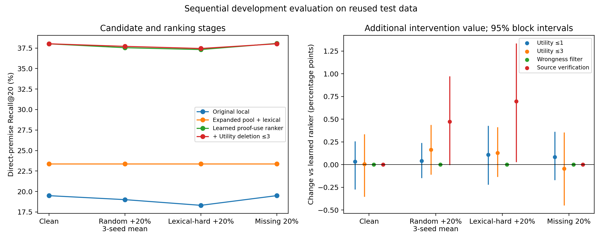

# 순서대로 실행한 검색 개선과 간선 제거 ML 재평가

2026-11-23 · `sequential-v2` · 실제 완료 실행에서 생성.

## 결론과 해석 범위

후보 확보 방식을 고정하고, 실제 학습 증명의 직접 인용을 정답으로 순위를 학습한 뒤, 그 검색기를 고정해 간선 제거 ML을 다시 실험했다. 정상 조건에서 새 순위 검색의 Recall@20은 **38.02%**였다. 미관측 오류 두 시드의 조건에서는 효용 ML의 추가 이득이 명확하지 않았다. 오류 분류 일괄 필터는 검증에서 보류가 선택되어 시험에서도 관계를 삭제하지 않았다.

이 결과는 기존 시험 질문567개/25개 원문 블록을 **재사용한 후속 개발 평가**이다. 이미 실패 분석에 사용한 시험 집합이므로 새 독립 데이터에서 재현된 성능이라고 주장하지 않는다. 단계별 선택은 학습·검증에서 마친 뒤 시험에 적용했다. 최초 설정, 기존 결과·모델·보고서와 ZIP은 변경하지 않았다.

정답은 한 원문 증명의 직접 인용이다. 학습 모델은 이 인용 관계를 통계적으로 예측하며, 모든 가능한 증명에서의 필수 관계나 논리적 필요충분성을 증명하지 않는다. 자연어 답변·새 증명 생성 성공률은 측정하지 않았다.

## 1단계 — 출발점과 후보 확보

선택한 설정은 `hybrid64_h2`이다. 기본 어휘 후보64개, 현재 출발 관계가 있는 시드16개와 어휘 시드8개, 과거 배경 증명의 관측 인용 수 상위32개를 조합한다. 두 단계의 가중 탐색 후 최대256개 후보를 확보한다. 전이는 최대2,048개다. 막힌 시드를 포함하더라도 기본 어휘·과거 인용 후보를 남겨 빈 확장을 보완한다.

과거 인용 수는 질문보다 앞선 **관측 배경 증명**에서 계산한다. 질문 자신의 증명, 미래 증명, 정답이나 주입 표시를 읽지 않는다. 검증·시험 증명 출발 간선과 범위 경계의 종단 처리를 그대로 유지했고 범위 밖 노드를 추가하지 않았다.

검증에서 후보 포함률은62.24%, 후보 내 Recall@20 상한은61.55%였다. 같은256개 한도의 전역 어휘 후보 포함률은38.29%였다. 시험 결과는 아래와 같다. 모든 값은 질문별 평균 퍼센트다.

| 조건 | 기존 후보 포함률 | 새 후보 포함률 | 새 후보 내 Top20 상한 | 전역 어휘256 후보 |
| --- | --- | --- | --- | --- |
| 정상 | 27.44 | 68.46 | 68.02 | 41.42 |
| 무작위+5% | 27.55 | 68.39 | 67.95 | 41.42 |
| 무작위+20%,3시드 평균 | 28.53 | 68.57 | 68.14 | 41.42 |
| 무작위+20%,미관측2시드 | 28.52 | 68.64 | 68.22 | 41.42 |
| 어휘유사 오류+20% | 28.46 | 68.40 | 68.01 | 41.42 |
| 관계20% 누락 | 25.19 | 67.48 | 67.08 | 41.42 |

기존 후보보다 큰 집합을 쓰므로 기존 검색기와 계산 예산이 같지는 않다. 동일한256개 한도의 어휘 후보를 별도 비교했다. 후보만 확장하고 같은 어휘 점수로 정렬하면 상위20개는 전역 어휘 검색과 같아진다. 이를 그래프 추론 능력의 개선으로 부르지 않는다.

## 2단계 — 실제 증명 인용을 학습한 순위

학습 질문의 (질문,후보)에 원문 인용 여부를 붙였다. 질문·후보의 결론과 가정 간 유사도, 가정·변수 제약 수, 명제 역할·길이, 과거 인용 및 탐색 지지를42개 특징으로 사용했다. 개별 정리/질문 식별자와 정답·주입 표시·시험 증명은 특징에 포함하지 않았다. 모든 양성과 가까운 음성·표집 음성으로 질문 가중치를 균형화했다.

Logistic Regression과 histogram gradient boosting을 비교해 검증에서 `boost_31`을 골랐다. 학습 후보쌍은328,345개, 그중 양성은32,281개였다. 검증 Recall@20은30.53%였고 동일 후보의 어휘 순위20.25%, 고정 혼합 점수23.00%와 비교했다. 개별 명제 ID를 외우는 임베딩이나 논리 검증기는 사용하지 않았다.

아래는 최종 시험의 각 단계와 간선 제거 결과다. 값은 직접 인용 Recall@20의 퍼센트다.

| 조건 | 기존 지역 검색 | 확장후 어휘 순위 | 증명 인용 순위 | 효용 ML≤3 | 오류 분류 일괄 필터 | 출처 확인 |
| --- | --- | --- | --- | --- | --- | --- |
| 정상 | 19.49 | 23.38 | 38.02 | 38.02 | 38.02 | 38.02 |
| 무작위+5% | 19.23 | 23.38 | 37.89 | 38.04 | 37.89 | 38.02 |
| 무작위+20%,3시드 평균 | 19.01 | 23.38 | 37.54 | 37.71 | 37.54 | 38.02 |
| 무작위+20%,미관측2시드 | 19.08 | 23.38 | 37.47 | 37.60 | 37.47 | 38.02 |
| 어휘유사 오류+20% | 18.31 | 23.38 | 37.32 | 37.45 | 37.32 | 38.02 |
| 관계20% 누락 | 19.50 | 23.38 | 38.07 | 38.02 | 38.07 | 38.07 |

후보 집합을 같게 두고 순위 모델만 바꾼 차이는 다음과 같다. 95% 구간은 원문 블록 bootstrap 2,000회이며 단위는퍼센트포인트(pp)다.

| 조건 | 학습 순위 − 같은 후보 어휘 순위(pp) |
| --- | --- |
| 정상 | +14.637 [+11.998, +17.505] |
| 무작위+5% | +14.506 [+11.847, +17.439] |
| 무작위+20%,3시드 평균 | +14.164 [+11.460, +17.240] |
| 무작위+20%,미관측2시드 | +14.094 [+11.392, +17.152] |
| 어휘유사 오류+20% | +13.939 [+11.204, +17.051] |
| 관계20% 누락 | +14.688 [+11.925, +17.633] |

정상 조건에서 기존 지역 검색보다 좋아진 질문은396개, 나빠진 질문은51개, 같은 질문은120개였다. 평균 개선이 모든 질문의 개선을 뜻하지 않는다. 이전 진단 사례와 가장 큰 악화 사례를 함께 남겼다. 아래 값도퍼센트다.

| 질문 | 정답 인용 수 | 기존 Recall | 새 후보 포함률 | 새 순위 Recall |
| --- | --- | --- | --- | --- |
| eulerpathpr | 26 | 0.00 | 53.85 | 30.77 |
| konigsberg | 25 | 4.00 | 52.00 | 28.00 |
| usgrfs | 2 | 50.00 | 100.00 | 100.00 |
| relopab | 2 | 50.00 | 50.00 | 0.00 |
| elimf | 2 | 50.00 | 100.00 | 0.00 |
| fssdmd | 2 | 50.00 | 100.00 | 0.00 |
| fssdm | 2 | 50.00 | 100.00 | 0.00 |
| upgr1pthond | 4 | 75.00 | 100.00 | 25.00 |

예를 들어 `eulerpathpr`는 원문 인용26개 중 기존0개에서 새 순위8개 회수로 바뀌었다. 반면 `elimf`는 정답2개가 모두 후보에 있었는데도 새 순위에서 둘 다 놓쳤다. 모델은 통계적으로 기록된 인용을 예측하며, 이처럼 정답 후보를 충분히 확보한 뒤에도 실패할 수 있다. [질문별 변화](runs/sequential_v2/base_ranker_query_changes.csv)와 [실제 근거 사례](runs/sequential_v2/worked_examples.json)를 보존했다.

## 3단계 — 새 검색기 위에서 간선 제거를 다시 학습

이전 검색기의 삭제 효과를 가져오지 않았다. 새 후보·특징·순위를 삭제 후 실제 재계산했다. 학습 원문 블록을3분할하고, 각 분할의 질문과 증명 출발 관계를 제외한 순위 모델로 그 질문들의 효과를 만들었다. 최종 순위 모델에 대한 학습 내 효과로 정책을 가르치는 과적합을 줄이려는 out-of-fold 절차다. OOF 모델과 전체 학습 모델의 학습 규모 차이는 남는다.

OOF 질문-조건 사례4,626개에서 후보 삭제 효과108,187개를 만들었다. 양의 효과442개, 음의 효과641개, 0효과107,104개였다. 관측 탐색 간선 중 최대24개를 평가하며, 정답·주입 표시로 후보를 고르지 않는다.

두 종류를 구분했다. **효용 ML**은 부호 있는 Recall@20 변화를 회귀한다. **오류 분류 ML**은 원문 증명에 없는 거짓 귀속을 분류한다. 오류 표시는 후자의 학습 정답으로만 쓰며 입력 특징에는 넣지 않는다. 최대1개/3개 삭제 또는 삭제 보류를 검증에서 선택했다. 3개 삭제 효과는 단일 효과를 더하지 않고 재검색했다.

선택 내역: utility1: utility_boost, 임계값 0.0, 검증 평균 변화 +0.089pp; utility3: utility_boost, 임계값 0.0, 검증 평균 변화 +0.074pp; wrongness1: wrongness_boost, 임계값 0.9, 검증 평균 변화 +0.014pp; wrongness3: wrongness_boost, 임계값 0.9, 검증 평균 변화 +0.014pp; wrongness_filter: wrongness_boost, 임계값 1.01, 검증 평균 변화 +0.000pp.

단일 효과 대부분이0인 학습 분할을 확인한 뒤, 검증·시험 전에 [다수 관계 필터 비교](SEQUENTIAL_V2_FILTER_FOLLOWUP.md)를 추가했다. 같은 오류 분류기로 관측 탐색 간선 전체를 점수화하고 임계값과 최대24/64/128개 억제를 검증에서 고른다. 기존 최대1/3개 비교와 구분하며 실제 일괄 재검색 및 같은 수의 무작위 삭제와 비교한다. 이 정책은 최대24개 후보의 단일 효용 오라클보다 넓은 행동 공간과 계산량을 사용하므로 그 오라클이 필터의 상한은 아니다.

새 순위 검색을 기준으로 한 **추가 효과**는 다음과 같다.

| 조건 | 효용 ML≤1 변화(pp) | 효용 ML≤3 변화(pp) | 오류 분류 ML≤3 변화(pp) | 오류 일괄 필터 변화(pp) |
| --- | --- | --- | --- | --- |
| 정상 | +0.034 [-0.274, +0.258] | +0.005 [-0.355, +0.334] | +0.000 [+0.000, +0.000] | +0.000 [+0.000, +0.000] |
| 무작위+5% | +0.014 [-0.113, +0.135] | +0.155 [+0.001, +0.363] | +0.000 [+0.000, +0.000] | +0.000 [+0.000, +0.000] |
| 무작위+20%,3시드 평균 | +0.041 [-0.148, +0.240] | +0.164 [-0.110, +0.437] | +0.000 [+0.000, +0.000] | +0.000 [+0.000, +0.000] |
| 무작위+20%,미관측2시드 | +0.024 [-0.180, +0.221] | +0.125 [-0.175, +0.447] | +0.000 [+0.000, +0.000] | +0.000 [+0.000, +0.000] |
| 어휘유사 오류+20% | +0.108 [-0.220, +0.427] | +0.129 [-0.134, +0.413] | +0.000 [+0.000, +0.000] | +0.000 [+0.000, +0.000] |
| 관계20% 누락 | +0.083 [-0.170, +0.363] | -0.045 [-0.448, +0.355] | +0.000 [+0.000, +0.000] | +0.000 [+0.000, +0.000] |

원문 출처 확인은 공개 배경 증명의 인용표로 잘못된 귀속을 전역 정리하는 더 강한 입력 접근 비교군이다. 질문 정답을 읽지는 않지만 최대1/3개 행동 예산의 ML과 동일 비용 비교는 아니다. 무작위 개수 일치 삭제·관련도 삭제·단일 효용 오라클도 [전체 표](runs/sequential_v2/summary.csv)에 포함했다. 구간은 고정된 학습·선택 모델에 조건부이고 다중 비교를 보정한 확정적 검정이 아니다.

## 실제로 무엇을 삭제했는가

효용이 좋아지는 관계 제거와 잘못된 관계 판별은 서로 다른 목표다. 효용 ML은 실제 관계를 삭제할 수도 있으므로 '거짓 관계만 고쳤다'고 부르지 않는다. 원문 귀속 기준으로 삭제한 관계와 손해를 따로 기록했다. 무작위 반복 조건의 삭제 수·정밀도는 질문 내 평균과 합계로 계산했다. 실행·개선·악화 비율은 개별 시드의 사건 여부를 먼저 계산한 뒤 질문 안에서 평균했다. 반복을 독립 질문으로 세지 않는다.

| 조건 | 정책 | 평균 삭제 수 | 삭제 실행 질문 비율 | 삭제 중 거짓 귀속 비율 | 회수율 악화 질문 비율 |
| --- | --- | --- | --- | --- | --- |
| 정상 | utility3 | 2.589 | 95.06% | 0.00% | 3.17% |
| 정상 | wrongness3 | 0.019 | 1.94% | 0.00% | 0.00% |
| 정상 | wrongness_filter | 0.000 | 0.00% | — | 0.00% |
| 무작위20% | utility3 | 2.702 | 96.83% | 11.99% | 2.12% |
| 무작위20% | wrongness3 | 0.173 | 15.70% | 93.20% | 0.00% |
| 무작위20% | wrongness_filter | 0.000 | 0.00% | — | 0.00% |
| 미관측2시드 | utility3 | 2.726 | 97.00% | 12.10% | 2.47% |
| 미관측2시드 | wrongness3 | 0.174 | 15.78% | 90.86% | 0.00% |
| 미관측2시드 | wrongness_filter | 0.000 | 0.00% | — | 0.00% |
| 어휘유사 오류 | utility3 | 2.695 | 96.65% | 15.12% | 2.47% |
| 어휘유사 오류 | wrongness3 | 0.041 | 3.88% | 60.87% | 0.00% |
| 어휘유사 오류 | wrongness_filter | 0.000 | 0.00% | — | 0.00% |

오류 분류기의 점수 자체는 아래와 같다. 동일 간선이 여러 질문에 나타나면 점수를 간선별 평균하고, 서로 다른 간선으로 기술적 AUC를 계산했다. 독립적인 간선 모집단에 대한 유의성 검정은 아니다. 정상 조건은 거짓 간선이 없어 AUC를 계산하지 않는다.

| 조건 | 서로 다른 관측 간선 | 그중 거짓 귀속 | ROC-AUC | Average precision |
| --- | --- | --- | --- | --- |
| hard20_s17 | 5430 | 788 | 0.520 | 0.152 |
| random05_s17 | 5216 | 243 | 0.758 | 0.208 |
| random20_s17 | 5356 | 810 | 0.825 | 0.486 |
| random20_s29 | 5451 | 813 | 0.788 | 0.425 |
| random20_s43 | 5421 | 798 | 0.774 | 0.432 |

무작위20%의 미관측 두 시드에서 오류 분류≤3 정책은 삭제 중 거짓 귀속 비중 약90.86%였지만 Recall@20 변화는0이었다. 같은 조건의 효용≤3 정책에서는 삭제 중 거짓 귀속 비중이 약12.10%였다. 효용 정책의 대부분 삭제는 실제 관계에 대한 질문별 억제이므로 오류 정정과 동일하게 해석하지 않는다. 어휘상 유사한 거짓 귀속에서 분류 AUC는약0.520으로, 무작위 오류보다 판별이 어려웠다.

## 예산·완전 근거·비용

K=20에서 선택한 모델을 재학습 없이 적용했다. 다음 표는 무작위20% 세 시드 평균이다. Recall과 전체 인용 회수율은퍼센트다.

| K | 새 순위 검색 Recall | +효용 ML≤3 Recall | 추가 변화(pp) | 새 순위 전체 인용 회수율 |
| --- | --- | --- | --- | --- |
| 10 | 29.11 | 29.21 | +0.098 [-0.102, +0.286] | 7.47 |
| 20 | 37.54 | 37.71 | +0.164 [-0.110, +0.437] | 9.99 |
| 40 | 47.35 | 47.32 | -0.034 [-0.201, +0.117] | 14.05 |

질문별 실제 반환 수·공백 기준 형식 토큰 수와 탐색량은 원시 표에 보존했다. 원시 표의 candidate/transition 항목은 삭제 전 기본 후보 구성의 값이며, 간선 정책의 추가 재검색까지 합친 총 탐색량은 아니다. 정책의 실제 추가 추론 비용은 별도 지연 표본으로 비교한다. 같은 출력 상한이 같은 토큰·계산 비용을 뜻하지 않는다. 토큰은 LLM 토크나이저 토큰이 아니다. 새 순위 모델과 간선 정책 모두 CPU에서 실행했고 유료 모델 API를 사용하지 않았다.

별도 추론 실행42개에서 순위 검색의 중앙값은13.63ms, 효용≤3 정책 포함 중앙값은22.51ms였다. 이는 이미 색인된 형식 질문과 적재된 모델을 쓰며 모델/인덱스 로딩과 모든 사후 효과·오라클 계산을 제외한다. 자유로운 자연어 입력을 포함한 서비스 지연으로 해석하지 않는다. 시험 평가의 총 계산시간382.8초에는 많은 개입 정답·비교군 재검색도 들어 있으므로 추론 비용과 구분한다.

## 검증과 재현

자동 검사14개가 통과했다. 기존 배포 파일70개가 그대로임을 확인했다. OOF3개 분할의 질문/블록 비중첩과 증명 간선 가림을 확인했고, 실제 간선을 지운 그래프로 단일 삭제126개와 추론/정책 출력210개를 재실행해 일치시켰다. 예측 경로는 질문 정답을 제거한 입력으로 실행한다.

설정과 설계는 [프로토콜](SEQUENTIAL_V2_PROTOCOL.md), [실행 기록](SEQUENTIAL_V2_LOG.md), [재현 안내](README_V2.md)에 있다. 기존 시험 자료 재사용과 단일 형식 출처, 원문 블록 간 관련성, 오류 모형의 인위성, 일반 논리 보조정리까지 포함한 한 증명 인용 정답이라는 한계는 유지된다. 독립적인 신규 질문과 실제 논리적 가정 누락·답변/증명 검증에서의 재현은 아직 하지 않았다.

