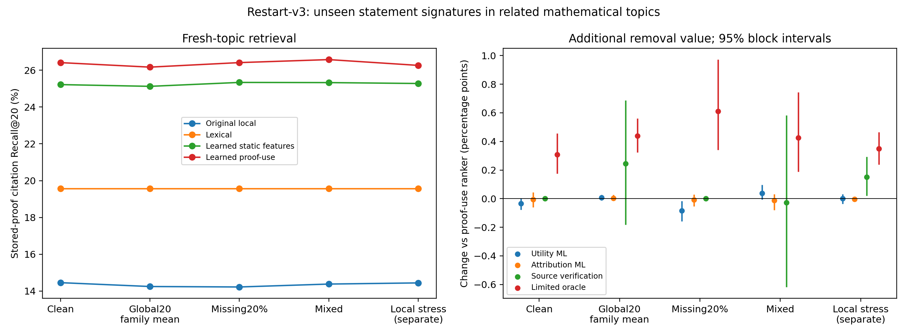
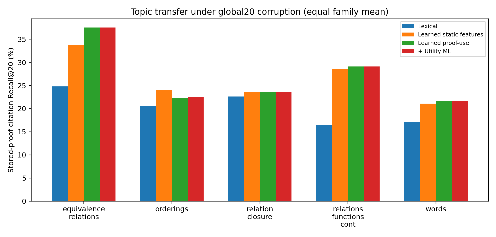

# 처음부터 재실행한 수학 근거 검색 실험

2026-11-25 · `restart-v3` · 완료한 실제 실행에서 생성.

## 확인한 결과

새 주제 시험 582개에서 정상 조건의 증명 인용 Recall@20은 **26.41%**였다. 사전 지정한 전역 오류 평균에서 효용 ML의 추가 개선을 확정할 수 없었다. 주 비교의 추가 효과는 **+0.006 [-0.012, +0.028]pp**였다.

이전 실행의 모델·오류 그래프·효과 정답을 재사용하지 않고 원문 확인, 데이터 분리, 색인, 순위 모델, 개입 정답, 정책을 새로 만들었다. 개발 자료는 이전에 사용한 범위를 다시 분할했다. 시험은 기존 색인에 canonical signature가 전혀 없었던 관련 주제의 정리로 제한했다. 같은 Metamath 원문은 과거에 전역 파싱·확인한 적이 있으므로 새로운 원문 출처에 대한 검증이라고 주장하지 않는다. 정리 서명의 신규성은 수학적 의미나 유사 정리 전체의 독립성을 보장하지 않는다.

평가 정답은 **한 저장 증명의 직접 인용**이다. 이를 모든 가능한 증명의 논리적 필수 관계로 부르지 않는다. 자연어 답변 정확도와 새로운 증명 생성 성공률은 이번 측정 범위에 포함하지 않았다.

## 자료와 분리

주 실험 그래프는 집합·관계·함수·유한집합과 그래프 경로·오일러 정리의 관련 범위에 단어/문자열, 관계의 폐포, 동치관계, 순서, 관계·함수 후속 단원을 더한 범위다. 전체 Metamath 검증은 출처 확인 절차이고 전체 라이브러리를 주 검색 실험에 사용한 것이 아니다.

- 핵심 정리 4,643개, 경계 문서 2,223개, 전체 색인 6,866개.
- 검색 가능한 원문 인용 관계 29,862개. 새 주제 전체의 증명 출발 관계를 가렸고, 질문·동일 서명·미래 정리를 후보에서 제외했다.
- 질문 분리: `{"rank_train": 2306, "policy_train": 735, "validation": 639, "test": 582}`. 순위 학습·정책 학습·검증·시험의 원문 블록은 분리했다.
- 신규 시험 582개, 원문 블록 38개. 이전 색인 서명과의 겹침은 0개였다.
- 시험 직접 인용 9,752개 중 색인 안의 인용은 9,155개다. 질문별 평균 색인 포함률은 94.91%이며, 색인 밖 정답이 있는 질문은 247개다. [정답 가용성 표](runs/restart_v3/test_gold_availability.csv)를 남겼다.

색인 구성 기록: 사전 선택 핵심 주제의 문서와 공개 증명에서만 유도한 단일 단계 경계로 구성했다. 시험 증명의 의존 목록으로 경계를 확대하지 않고 색인 밖 정답을 분모에 보존했다.

## 검색과 학습 순서

후보 확보는 어휘 기본 후보·확장 가능한 출발점·과거 관측 증명의 인용 정보를 조합한다. 전역 어휘와 기존 고정 지역 탐색을 함께 실행했다. 기존 지역 비교는 예전 저장 점수를 가져온 것이 아니라 **새 공통 색인·어휘 점수·오류 그래프에서4시드/2단계 원리를 다시 실행**한 결과다. 새 TF-IDF는 모든 비교에 같은 public-fit 설정과 sublinear TF를 사용했다. 따라서 이전 v2의38.02%와 새 점수를 직접 비교해 변화 원인을 주장하지 않는다.

순위 학습은 실제 학습 증명의 직접 인용을 예측하며, 텍스트·정적 메타데이터를 사용하는 순위 비교와 관측 그래프 지지까지 쓰는 비교를 구분했다. 관측 그래프 특징10개를 제외한 모델도 원문 순서 거리, 공리/정의/경계 역할, 가정·서로 다른 변수 제약 수, 형식 기호 수는 유지한다. 이 비교도 그래프가 만든 같은 후보를 사용한다. **관측 그래프 특징이 없는 재순위**이며 순수한 수식 유사도나 그래프를 전혀 쓰지 않는 전체 검색기는 아니다. 동일 후보의 확장 후 어휘 순위와 작은64개 후보 비교도 저장했다.

순위 모델을 고정한 뒤 별도의 `policy_train` 블록에서 실제 간선을 억제하고 후보·특징·순위를 다시 계산해 개입 효과를 새로 만들었다. 정책 학습 질문은 순위 모델의 정답 학습에 사용하지 않았다. 이 분리로 이전 OOF 모델과 최종 배포 모델 사이의 차이를 피했다. 검증에서 후보 설정·순위·간선 정책을 순서대로 선택하고 시험 전에 고정했다.

검증이 선택한 주 모델은 `boost_31`이다. 텍스트·정적 메타데이터를 쓰고 관측 그래프 특징을 제외한 별도 모델과 같은 후보에서 비교했다.

1단계 선택: `{"variant": {"name": "hybrid64_h2", "lexical": 64, "prior": 32, "seed_pool": 128, "expandable_seeds": 16, "lexical_seeds": 8, "hops": 2}, "validation": {"variant": "hybrid64_h2", "coverage": 0.7125762547813392, "ceiling20": 0.7081594777386302, "transitions": 336.52582159624416, "lexical_coverage": 0.44165517630565815}, "selected_before_rank": true}`

2단계 선택: `{"model": "boost_31", "validation": {"model": "boost_31", "recall": 0.38162396795074915, "ndcg": 0.3374560488080886, "complete": 0.1189358372456964, "complexity": 3}, "stage1_sha256": "07150039a8e3555c9d26b1e9eef48742679c48f53acade363ecb99f0a462af99", "selected_before_policy": true}`

추가 간선 학습은 부호 있는 실제 회수율 변화를 예측하는 **효용 모델**과 **거짓 증명 인용 귀속 분류기**로 나눴다. 두 종류는 다른 목표이며 올바른 인용도 질문별 효용 때문에 억제될 수 있다. 주입 간선을 거짓 수학 명제라고 표현하지 않는다.

검증에서는 최대1/3/8개 후보 정책을 실제로 재검색해 비교했다. 시험과 배포 재실행 검사는 아래에서 선택한 정책에 대한 결과다. 선택되지 않은 다중 삭제 정책의 배포 성능을 검증했다고 주장하지 않는다.

| 정책 | 모델 | 선택한 최대 삭제 수 | 임계값 | 검증 변화(pp) |
| --- | --- | --- | --- | --- |
| utility | utility_boost | 1 | 0.002 | +0.0229 |
| wrongness | wrongness_boost | 1 | 0.8 | +0.0190 |

## 전체 성능과 후보 한계

아래 값은 질문별 직접 인용 Recall@20의 퍼센트다. 오류 시드 반복은 각 질문 안에서 평균했고, 전역20%는 무작위와 어휘유사 두 유형의 평균을 동일 가중했다. 정상, 누락, 혼합, 탐색 출발점 스트레스는 주 전역20% 평균에 합치지 않았다.

| 조건 | 기존 지역 | 어휘 | 텍스트·정적 특징 | 증명 인용 학습 | +효용 ML | +오류 분류 ML |
| --- | --- | --- | --- | --- | --- | --- |
| 정상 | 14.46 | 19.56 | 25.22 | 26.41 | 26.38 | 26.41 |
| 무작위+20%, 두 시드 | 14.35 | 19.56 | 25.12 | 26.32 | 26.31 | 26.31 |
| 어휘유사+20%, 두 시드 | 14.14 | 19.56 | 25.13 | 26.02 | 26.04 | 26.03 |
| 전역20%: 두 오류 유형 평균 | 14.25 | 19.56 | 25.12 | 26.17 | 26.17 | 26.17 |
| 관계20% 누락 | 14.22 | 19.56 | 25.34 | 26.41 | 26.33 | 26.41 |
| 삭제·추가 혼합 | 14.38 | 19.56 | 25.33 | 26.58 | 26.62 | 26.57 |
| 탐색 출발점 오류: 별도 스트레스 | 14.44 | 19.56 | 25.28 | 26.26 | 26.26 | 26.26 |

후보 집합과 순위의 효과를 별도로 확인했다. 아래 차이의 단위는 퍼센트포인트다.

| 조건 | 증명 인용 − 어휘(pp) | 주 순위 − 같은 후보 정적 특징 순위(pp) | 증명 인용256 − 동일 모델64(pp) |
| --- | --- | --- | --- |
| 정상 | +6.848 [+3.438, +9.869] | +1.194 [+0.236, +2.164] | -0.080 [-1.137, +0.914] |
| 무작위+20%, 두 시드 | +6.750 [+3.364, +9.742] | +1.197 [+0.254, +2.257] | +0.131 [-0.882, +1.010] |
| 어휘유사+20%, 두 시드 | +6.455 [+2.933, +9.560] | +0.892 [-0.132, +2.104] | +0.302 [-0.779, +1.287] |
| 전역20%: 두 오류 유형 평균 | +6.603 [+3.114, +9.647] | +1.044 [+0.075, +2.160] | +0.217 [-0.745, +1.080] |
| 관계20% 누락 | +6.849 [+3.330, +9.989] | +1.077 [+0.142, +2.035] | -0.143 [-1.310, +0.984] |
| 삭제·추가 혼합 | +7.012 [+3.497, +10.108] | +1.250 [+0.287, +2.291] | +0.446 [-0.735, +1.494] |
| 탐색 출발점 오류: 별도 스트레스 | +6.697 [+3.302, +9.725] | +0.984 [+0.074, +1.935] | +0.051 [-0.910, +0.946] |

| 조건 | 후보 포함률(%) | Top20 후보 상한(%) | 평균 후보 수 | 평균 전이 수 | 관측 거짓 간선 |
| --- | --- | --- | --- | --- | --- |
| 정상 | 54.81 | 54.51 | 256.0 | 232.4 | 0.00 |
| 무작위+20%, 두 시드 | 54.95 | 54.63 | 256.0 | 307.7 | 51.84 |
| 어휘유사+20%, 두 시드 | 55.27 | 54.95 | 256.0 | 306.5 | 50.19 |
| 전역20%: 두 오류 유형 평균 | 55.11 | 54.79 | 256.0 | 307.1 | 51.01 |
| 관계20% 누락 | 53.86 | 53.57 | 256.0 | 168.4 | 0.00 |
| 삭제·추가 혼합 | 55.17 | 54.83 | 256.0 | 232.2 | 22.39 |
| 탐색 출발점 오류: 별도 스트레스 | 54.91 | 54.60 | 256.0 | 252.7 | 7.23 |

같은256개 한도의 전역 어휘 후보와 비교하면 정상 후보 포함률은 35.27%에서 54.81%로 높아졌다. 각 직접 검색 비교의 실제 후보 수를 함께 제시한다.

| 정상 조건 방법 | 평균 후보 수 | 정답 후보 포함률(%) | Top20 후보 상한(%) | Recall@20(%) |
| --- | --- | --- | --- | --- |
| old_local | 14.9 | 16.10 | 16.09 | 14.46 |
| lexical | 256.0 | 35.27 | 35.27 | 19.56 |
| expanded_text | 256.0 | 54.81 | 54.51 | 19.56 |
| proof_small64 | 64.0 | 36.10 | 36.10 | 26.49 |
| proof_ranker | 256.0 | 54.81 | 54.51 | 26.41 |

이 표의 후보·전이·포함률은 삭제 없는 기본 검색의 값이다. 원시 결과에서 전역 어휘·기존 지역·작은64개 직접 비교와 출처 확인은 각자의 실제 후보 수와 전이를 기록하며, 추가 학습·무작위·오라클 정책의 항목은 개입 전 기본 검색 값이다. 정책별 추가 재검색까지 합친 총량이 아니다. 작은64개 조건은 같은 모델에 후보 한도와 어휘/과거 인용 앵커를 줄인 사전 정의 조합을 적용한 이동 검사이며, 한도만 바꾼 인과 효과나64개에서 재학습한 최적 모델과의 비교가 아니다.

정상 조건의 놓친 근거를 서로 겹치지 않게 분해했다. `out_of_index`는 색인 밖, `indexed_but_ineligible`은 원문 순서·서명 제한, `eligible_but_outside_pool`은 후보 미포함, `capacity20`은 후보 안 정답 수가20을 넘는 부분, `avoidable_within_pool`은 같은 후보의 완벽한 순위가 추가로 찾을 수 있는 부분이다. 각 질문 안에서 모두 더하면 전체 정답 질량이 된다.

| 정상 조건 정답 인용의 위치 | 질문별 평균 비중(%) |
| --- | --- |
| retrieved | 26.41 |
| out_of_index | 5.09 |
| indexed_but_ineligible | 0.00 |
| eligible_but_outside_pool | 40.10 |
| capacity20 | 0.30 |
| avoidable_within_pool | 28.10 |

## 오류 자체가 검색을 얼마나 바꾸었는가

동일 질문·고정 검색기에서 오류 조건과 정상 조건을 직접 짝지었다. 음의 값은 악화이고 양의 값은 개선이다. 오류가 언제나 해롭다고 가정하지 않는다. 악화/노출 사건은 개별 오류 시드에서 먼저 계산한 뒤 질문 안에서 평균했다.

| 조건 | 오류 조건 − 동일 질문 정상(pp) | 오류로 회수율 악화 비율 | 거짓 간선 탐색 노출 비율 |
| --- | --- | --- | --- |
| 무작위+20%, 두 시드 | -0.097 [-0.509, +0.279] | 10.14% | 92.18% |
| 어휘유사+20%, 두 시드 | -0.392 [-0.956, +0.184] | 17.18% | 92.27% |
| 전역20%: 두 오류 유형 평균 | -0.245 [-0.686, +0.182] | 13.66% | 92.23% |
| 관계20% 누락 | +0.001 [-0.505, +0.528] | 12.71% | 0.00% |
| 삭제·추가 혼합 | +0.164 [-0.323, +0.668] | 13.92% | 90.03% |
| 탐색 출발점 오류: 별도 스트레스 | -0.150 [-0.292, -0.021] | 4.47% | 92.78% |

정상 조건에서 기존 지역 검색보다 좋아진 질문은 405개, 나빠진 질문은 46개, 같은 질문은 131개였다. 같은 출력 상한이 같은 후보 구성·시간·형식 토큰 비용을 뜻하지 않는다. 실제 반환 수와 형식 공백 토큰 수를 원시 표에 남겼다.

## 새 검색기 위 간선 제거의 추가 효과

| 조건 | 효용 ML 변화(pp) | 오류 분류 변화(pp) | 출처 확인 변화(pp) | 제한된 단일 삭제 오라클(pp) |
| --- | --- | --- | --- | --- |
| 정상 | -0.033 [-0.078, +0.000] | -0.006 [-0.059, +0.044] | +0.000 [+0.000, +0.000] | +0.307 [+0.174, +0.456] |
| 무작위+20%, 두 시드 | -0.009 [-0.040, +0.021] | -0.003 [-0.026, +0.020] | +0.097 [-0.279, +0.509] | +0.395 [+0.242, +0.567] |
| 어휘유사+20%, 두 시드 | +0.021 [-0.014, +0.065] | +0.010 [-0.019, +0.043] | +0.392 [-0.184, +0.956] | +0.481 [+0.310, +0.687] |
| 전역20%: 두 오류 유형 평균 | +0.006 [-0.012, +0.028] | +0.004 [-0.014, +0.026] | +0.245 [-0.182, +0.686] | +0.438 [+0.324, +0.560] |
| 관계20% 누락 | -0.084 [-0.157, -0.016] | -0.007 [-0.054, +0.030] | +0.000 [+0.000, +0.000] | +0.611 [+0.341, +0.972] |
| 삭제·추가 혼합 | +0.039 [-0.005, +0.096] | -0.011 [-0.080, +0.032] | -0.028 [-0.617, +0.583] | +0.425 [+0.188, +0.744] |
| 탐색 출발점 오류: 별도 스트레스 | -0.000 [-0.035, +0.030] | -0.004 [-0.012, +0.000] | +0.150 [+0.021, +0.292] | +0.349 [+0.239, +0.466] |

같은 수의 무작위 삭제 대비 전역20%의 추가 차이는 효용 ML +0.015 [-0.008, +0.043]pp, 오류 분류 ML +0.021 [-0.007, +0.053]pp였다. 두 차이 모두0을 포함하는 구간으로, 이번 선택 정책이 같은 행동 수의 무작위 삭제보다 개선한다고 확정할 수 없다. 누락 조건에서는 효용 정책 변화가 -0.084 [-0.157, -0.016]pp로 악화 방향이었다. 이 수치도 여러 보조 비교 중 하나라는 제한을 유지한다.

95% 구간은 시드를 먼저 질문 안에서 평균한 뒤 원문 블록을 bootstrap 2,000회 재표집한 기술적 구간이다. 고정된 선택 모델에 조건부이며 학습 변동 전체나 다중 비교를 보정한 확정적 유의성 검정이 아니다. 특히 주제별 작은 블록 집합의 구간을 넓은 수학 영역의 보장으로 해석하지 않는다.

개수 일치 무작위 삭제는 각 질문의 행동 수와 허용 간선 후보를 맞췄다. 출처 확인은 공개 증명 인용표로 잘못된 귀속을 확인하는 더 강한 입력 비교다. 단일 삭제 오라클은 제한된 후보 안에서 사후 효과를 보는 진단이며 달성 가능한 예측기 성능이 아니다.

| 조건 | 정책 | 평균 삭제 수 | 실행 비율 | 삭제 중 거짓 귀속 | 회수율 악화 비율 |
| --- | --- | --- | --- | --- | --- |
| 정상 | utility | 0.328 | 32.82% | 0.00% | 0.52% |
| 정상 | wrongness | 0.244 | 24.40% | 0.00% | 0.34% |
| 정상 | matched_utility | 0.328 | 32.82% | 0.00% | 0.52% |
| 정상 | matched_wrongness | 0.244 | 24.40% | 0.00% | 0.34% |
| 전역20%: 두 오류 유형 평균 | utility | 0.291 | 29.12% | 14.16% | 0.47% |
| 전역20%: 두 오류 유형 평균 | wrongness | 0.540 | 53.95% | 58.12% | 0.30% |
| 전역20%: 두 오류 유형 평균 | matched_utility | 0.291 | 29.12% | 11.06% | 0.30% |
| 전역20%: 두 오류 유형 평균 | matched_wrongness | 0.540 | 53.95% | 12.82% | 0.26% |
| 탐색 출발점 오류: 별도 스트레스 | utility | 0.304 | 30.41% | 6.21% | 0.17% |
| 탐색 출발점 오류: 별도 스트레스 | wrongness | 0.299 | 29.90% | 4.60% | 0.17% |
| 탐색 출발점 오류: 별도 스트레스 | matched_utility | 0.304 | 30.41% | 7.34% | 0.34% |
| 탐색 출발점 오류: 별도 스트레스 | matched_wrongness | 0.299 | 29.90% | 1.72% | 0.17% |

전역 오류를 실제 탐색에서 만났는지도 구분했다. 아래 층은 정답이나 사후 효과가 아니라 **기본 탐색에서 거짓 귀속을 하나라도 지났는가**로 정했다. 사건을 개별 시드에서 먼저 계산하고, 질문/유형별 사건 가중치와 효과 분자를 평균한 후 비율을 구했다. 따라서 시드 중 한 번이라도 노출되었는지로 만든 합집합 질문 비율이 아니다. 구간도 같은 질문·원문 블록 단위를 유지한다. 노출 없는 재표집은 분모0이므로 제외하며 유효 재표집 수를 CSV에 남겼다.

| 탐색 노출 층(전역20%) | 정책 | 해당 질문×시드 비중 | 추가 효과(pp) | 악화 비율 |
| --- | --- | --- | --- | --- |
| observed_false_edge | utility | 92.23% | +0.007 [-0.012, +0.030] | 0.51% |
| observed_false_edge | wrongness | 92.23% | +0.004 [-0.015, +0.028] | 0.33% |
| no_observed_false_edge | utility | 7.77% | +0.000 [+0.000, +0.000] | 0.00% |
| no_observed_false_edge | wrongness | 7.77% | +0.000 [+0.000, +0.000] | 0.00% |

탐색에서 거짓 간선이 없더라도 전역 인용 prior가 오류의 영향을 받을 수 있다. 이 층 분해는 관측적 기전 진단이며 노출 자체의 인과 효과를 식별한 결과가 아니다.

전역 오류 평균에서 오류 분류 정책이 삭제한 관계 중 58.12%가 거짓 귀속이었다. 이 정책의 실제 회수율 변화는 +0.004 [-0.014, +0.026]pp였다.

분류 점수 자체의 기술적 진단도 남겼다. 한 간선이 여러 질문에 등장하면 질문별 점수를 간선 안에서 평균한 뒤 서로 다른 간선을 대상으로 계산한다. 독립 간선 모집단에 대한 유의성 검정이 아니다. 거짓 귀속이 없는 조건은 AUC/AP를 계산하지 않는다.

| 조건 | 서로 다른 간선 | 거짓 귀속 | ROC-AUC | Average precision |
| --- | --- | --- | --- | --- |
| clean | 4554 | 0 | — | — |
| hard20_s419 | 4763 | 724 | 0.822 | 0.483 |
| hard20_s421 | 4746 | 759 | 0.831 | 0.519 |
| local8_s439 | 4737 | 253 | 0.332 | 0.049 |
| missing20_s431 | 4286 | 0 | — | — |
| mixed20_s433 | 4572 | 418 | 0.808 | 0.361 |
| random20_s401 | 4768 | 774 | 0.662 | 0.273 |
| random20_s409 | 4760 | 732 | 0.665 | 0.251 |

단일 간선 개입의 실제 효과 분포도 남겼다. 효과 대부분이 0이면 판별력이 부족한 것과 검색 구조에 개선 여지가 작은 것을 구분해야 한다.

| 조건 | 평가 간선 | 양의 효과 | 음의 효과 | 0효과 비율 |
| --- | --- | --- | --- | --- |
| clean | 12726 | 42 | 95 | 98.92% |
| hard20_s419 | 12799 | 82 | 85 | 98.70% |
| hard20_s421 | 12782 | 89 | 52 | 98.90% |
| local8_s439 | 12808 | 70 | 67 | 98.93% |
| missing20_s431 | 12620 | 96 | 122 | 98.27% |
| mixed20_s433 | 12673 | 67 | 82 | 98.82% |
| random20_s401 | 12765 | 52 | 67 | 99.07% |
| random20_s409 | 12751 | 42 | 72 | 99.11% |

## 주제 전이와 실패 사례

아래는 전역20% 두 오류 유형 평균이다.

| 주제 | 질문 | 원문 블록 | 어휘 Recall | 증명 인용 Recall | 효용 ML 추가(pp) |
| --- | --- | --- | --- | --- | --- |
| equivalence_relations | 121 | 5 | 24.82 | 37.54 | -0.005 [-0.016, +0.000] |
| orderings | 26 | 2 | 20.48 | 22.31 | +0.160 [+0.000, +0.245] |
| relation_closure | 83 | 7 | 22.64 | 23.56 | +0.000 [+0.000, +0.000] |
| relations_functions_cont | 70 | 3 | 16.40 | 29.13 | +0.013 [+0.000, +0.040] |
| words | 282 | 21 | 17.11 | 21.68 | -0.003 [-0.029, +0.025] |

공개 자료에만 적합한 어휘집에서 새 질문의 공백 구분 단일 토큰이 빠진 정도도 진단했다. 아래 비율은 각 질문 안에서 계산한 뒤 평균했다. 구조·변수 토큰을 포함하며 OOV만으로 검색 실패의 인과 원인을 확정하지 않는다. 원시 값과 실제 빠진 토큰은 별도 CSV/JSON에 있다.

| 주제 | 질문 | 평균 OOV 토큰 비율(%) | 평균 OOV 고유 토큰 비율(%) |
| --- | --- | --- | --- |
| equivalence_relations | 121 | 0.34 | 0.30 |
| orderings | 26 | 0.00 | 0.00 |
| relation_closure | 83 | 3.89 | 5.26 |
| relations_functions_cont | 70 | 0.27 | 0.38 |
| words | 282 | 0.51 | 0.79 |

| 유형 | 질문 | 주제 | 조건 | 회수율 변화(pp) | 놓친 실제 인용 |
| --- | --- | --- | --- | --- | --- |
| base_improvement | cnvex | relations_functions_cont | clean | +100.00 | — |
| base_improvement | coex | relations_functions_cont | clean | +100.00 | — |
| base_improvement | coexd | relations_functions_cont | clean | +100.00 | — |
| base_regression | ab2rexex | relations_functions_cont | clean | -100.00 | abrexex, abrexex2 |
| base_regression | issod | orderings | clean | -66.67 | ralrimivva, df-so |
| base_regression | errel | equivalence_relations | clean | -50.00 | df-er |
| policy_harm | ercl | equivalence_relations | missing20_s431 | -16.67 | errel |
| policy_harm | elfzelfzccat | words | mixed20_s433 | -14.29 | eleq2d |
| policy_harm | snecg | equivalence_relations | missing20_s431 | -12.50 | abbidv |
| policy_harm | uniqs2 | equivalence_relations | clean | -11.11 | eqtrd |
| policy_gain | soeq2 | orderings | hard20_s421 | +16.67 | — |
| policy_gain | relelec | equivalence_relations | mixed20_s433 | +12.50 | — |
| policy_gain | lenco | words | hard20_s421 | +11.11 | — |

실제 억제한 출발/목적 정리 이름, 원문 링크, 잃거나 새로 찾은 정답 인용은 [실패·근거 사례](runs/restart_v3/failure_and_worked_examples.json)에 있다. 개선 질문만 선택해 평균 결과를 설명하지 않는다.

## 예산과 오류 해석

K=20에서 선택한 모델·정책을 재학습하지 않고 K=10/40에도 적용했다.

| K | 증명 인용 Recall | +효용 ML Recall | 추가 변화(pp) | 전체 인용 회수율 |
| --- | --- | --- | --- | --- |
| 10 | 19.86 | 19.93 | +0.071 [+0.008, +0.175] | 3.57 |
| 20 | 26.17 | 26.17 | +0.006 [-0.012, +0.028] | 5.03 |
| 40 | 34.04 | 34.03 | -0.013 [-0.035, +0.008] | 5.71 |

전역 무작위/어휘유사 오류의 새 시드는 같은 오류 모형 안의 일반화다. 관계 누락·혼합은 별도의 오류 이동 조건이다. 탐색 출발점에 오류를 추가하는 조건은 정답을 보지 않고 관측 탐색과 수식 유사도로 결정한 **결정론적 조건부 스트레스**이며 현실의 평균 오류 분포가 아니다. `local8_s439`의439는 조건 이름이며 주입에 쓰는 난수 시드가 아니다. 하나의 스트레스 규칙을 여러 독립 시드 반복처럼 세지 않는다. 주입 불가능한 질문도 보존하고 주입/노출량을 보고했다. 이 조건에서만 얻는 개선을 일반적인 간선 제거 효과로 확대하지 않는다.

실행 시간 중 `offline_seconds`는 질문·조건별 개입 효과 정답 생성의 실제 측정 시간이며 서비스 추론 지연이 아니다. 같은 값이 방법·K 행에 반복되므로 모든 행을 더해 비용으로 계산하지 않는다. 총 wall time과 CPU 병렬 작업의 합계 시간도 구분한다. 후보·전이 카운터가 기본 검색 값이면 추가 정책 재검색 비용 전체로 읽지 않는다. 비용 항목과 독립 재실행 확인의 구체적 범위는 실행·감사 기록을 따른다.

별도 추론 표본 48개 질문·조건에서 기본 순위 검색 중앙값은 19.31ms, 효용 정책 포함은 24.86ms, 오류 분류 정책 포함은 27.29ms였다. 두 정책 행에 반복된 기본 시간은 질문·조건별 한 번만 집계했다. 색인·모델은 이미 적재했고 형식 질문을 사용했으며 명제쌍 특징 캐시는 예열되었을 수 있다. 모델/색인 로딩과 사후 효과 정답 생성은 제외하므로 자연어 서비스 지연으로 해석하지 않는다.

## 독립 재계산과 재실행 확인

감사에서 기존 파일 186개의 해시와 시험 전에 고정한 입력/예측 파일 21개를 확인했다. 공개 문서 4,661개만으로 어휘집·IDF 적합을 재구성했고, 저장된 측정 167,616행을 독립적으로 다시 계산했다. 미래 간선 접두 불변성 48회, 실제 그래프에서의 단일 삭제 132회, 정답을 전달하지 않은 선택 정책/물리적 그래프 재실행 96회가 통과했다. 정책 재실행 중 실제 삭제가 있었던 것은 33회이며 나머지는 보류였다. 이를 선택되지 않은 다중 정책의 재실행 수로 해석하지 않는다.

원문 파싱 때 연구 구현 체커로 48,420개 저장 증명의 치환·필수 가정·변수 제약·최종 스택을 확인했다. 이 로컬 체커의 통과를 독립 인증된 공식 검증기의 인증으로 표현하지 않는다. [감사 원문](runs/restart_v3/audit.json)과 [분석 일관성 확인](runs/restart_v3/analysis_checks.json)을 보존했다.

## 선택·재현 기록과 남은 한계

새 주제에서 확인한 가장 큰 남은 문제는 단일 관계 오류만이 아니다. 정상 정답 질량 중 40.10%는 검색 가능한데 후보에 들어오지 않았고, 28.10%는 같은 후보 안의 순위가 놓친 부분이었다. 그래프 특징을 더한 순위 모델은 정상 조건에서 같은 후보의 정적 특징 모델보다 +1.194 [+0.236, +2.164]pp 높았다. 그러나 고정 모델의 작은64개 조합과256개 조합의 차이는 -0.080 [-1.137, +0.914]pp여서 큰 후보 집합의 가치도 자동으로 전제하지 않는다.

전역 오류 자체의 평균 변화는 -0.245 [-0.686, +0.182]pp로 작고 불확실했다. 그럼에도 질문×오류 시드의 92.23%가 실제 거짓 간선을 탐색했다. 따라서 추가 ML의 작은 효과를 단순히 오류가 검색 경로에 나타나지 않은 탓으로 설명하기 어렵다. 단일 개입 효과의 희소성, 제한된 오라클의 작은 개선 여지, 새 주제에서의 분류·효용 전이를 함께 봐야 한다. 결정론적 local 스트레스에서 분류 AUC는 0.332였다. 전역 오류 학습이 국소 오류 판별까지 일반화한다는 보장도 얻지 못했다.

3단계 선택 원문:

```json
{
  "policies": {
    "utility": {
      "model": "utility_boost",
      "kind": "utility",
      "budget": 1,
      "threshold": 0.002,
      "validation_gain": 0.00022898516853339483,
      "validation_mean_deletions": 0.4480959833072509
    },
    "wrongness": {
      "model": "wrongness_boost",
      "kind": "wrongness",
      "budget": 1,
      "threshold": 0.8,
      "validation_gain": 0.0001898676537882865,
      "validation_mean_deletions": 0.3776734480959833
    }
  },
  "selected_before_test": true,
  "stage2_sha256": "2870edf724eaddaab0d6044717eefae5336450c49364754990f406a939407289"
}
```

완료 기록: `{"test_queries": 582, "conditions": 8, "methods": 12, "measurement_rows": 167616, "test_seconds": 683.8636138000002, "test_previously_indexed_signature_count": 0, "all_selections_locked_before_test": true}`

감사 기록: `{"all_passed": true, "old_files_unchanged": 186, "data_checks": {"queries": {"rank_train": 2306, "policy_train": 735, "validation": 639, "test": 582}, "fresh_test_signatures_absent_all_prior_index_nodes": 582, "split_group_and_signature_disjoint": true, "hidden_sources": 2205, "reference_edges_checked": 29862, "public_boundary_provenance_records_checked": 2223, "full_gold_and_unindexed_denominators_verified": true, "unindexed_gold_counts": {"rank_train": 0, "policy_train": 286, "validation": 197, "test": 597}, "fresh_raw_verification_receipt_present": true}, "audit_scope": "full_experiment", "audit_script_sha256": "3ab208117d0d4dcdc7a3ef24fb44ab0cda808aaf126e5553e63037102b385082", "experiment_checks": {"all_frozen_file_hashes_valid": 21, "fresh_idf_fit_reconstructed_without_heldout_nodes": 4661, "global_graph_contexts_checked": 12, "rank_policy_training_queries_disjoint": true, "rank_training_queries": 2306, "policy_training_queries": 735, "policy_effect_targets_and_features_reconstructed": 52217, "text_ranker_excludes_graph_columns": true, "all_metric_rows_independently_recalculated": 167616, "candidate_and_output_eligibility_checked_for_all_saved_rankings": true, "inference_query_contains_only_qid_node_signature": true, "future_edge_prefix_invariance_checks": 48, "single_deletion_materialized_replays": 132, "production_policy_and_materialized_replays": 96, "policy_replays_with_nonempty_actions": 33, "timing_sample_policy_rows": 96, "timing_note": "Already indexed formal queries and loaded models; pairwise-feature caches may be warm; model/index loading and offline intervention labels excluded."}, "audit_seconds": 56.84860299999855}`

정책 학습 효과 기록: `{"policy_cases": 2205, "effects": 52217, "positive": 183, "negative": 304, "zero": 51730, "wrong_candidates": 4005, "edge_features": ["q_source_cosine", "q_target_cosine", "endpoint_cosine", "source_predicted_use", "target_predicted_use", "source_in_pool", "target_in_pool", "target_predicted_rank", "target_score_minus_cutoff20", "target_lexical_anchor", "target_prior_anchor", "source_is_seed", "source_graph_depth", "target_graph_depth", "log_target_support", "log_target_path_mass", "log_source_outdegree", "log_target_outdegree", "log_historical_target_indegree", "source_hypotheses", "target_hypotheses", "source_is_boundary", "target_is_boundary", "source_target_goal_cosine", "source_hyp_to_target_goal_cosine", "base_cutoff_score", "log_candidate_count", "log_transition_count", "same_source_section"]}`

[프로토콜](RESTART_V3_PROTOCOL.md), [재현 안내](README_V3.md), [원시 요약](runs/restart_v3/summary.csv), [짝지은 차이](runs/restart_v3/comparisons.csv), [주제별 표](runs/restart_v3/topic_summary.csv)를 함께 제공한다. 단일 형식 출처, 기존 개발 범위 재사용, 정리의 의미적 유사성, 저장 증명 인용 정답의 불완전성, 인위적 오류 모형이라는 한계를 유지한다. 미실행된 자연어 답변·논리적 가정 누락·새 증명 검증의 성능은 보고하지 않는다.

형식 Metamath의 배경 증명에는 정확한 인용 출처가 있다. 운영 시 이 원문 인용표에 완전히 접근할 수 있다면, 거짓 증명 사용 귀속은 학습 없이 직접 대조해 확인할 수 있다. 이번 ML은 오염된 그래프와 관측 특징만 받으며 출처 확인 비교는 정상 인용표에 접근한다. 따라서 이 통제 실험만으로 Metamath 원래 메타데이터보다 ML이 실용적으로 필요하다고 주장하지 않는다. 출처가 없거나 확인 비용이 높은 상황, 또는 관계의 진위와 다른 질문별 효용 판단에서 ML의 가치가 생길 수 있지만 그 운영 조건의 실용성은 이번 실험으로 확립하지 않았다. 비형식 수학 문헌에서 실제 추출된 지식그래프 오류를 검증한 결과로도 확대하지 않는다.




