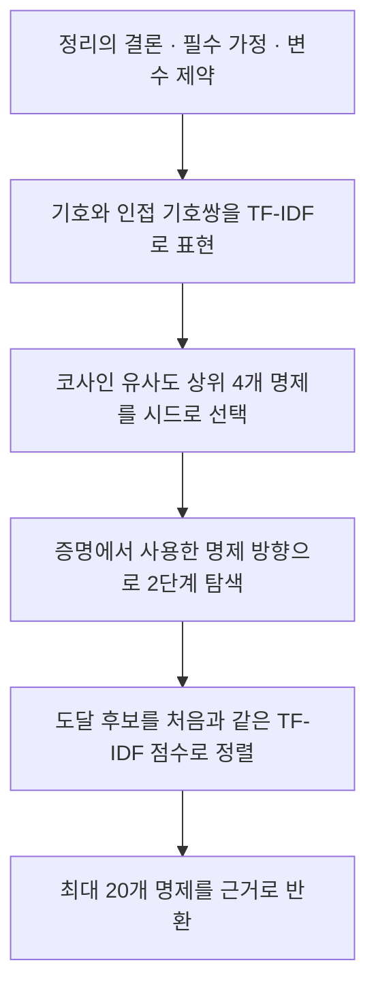
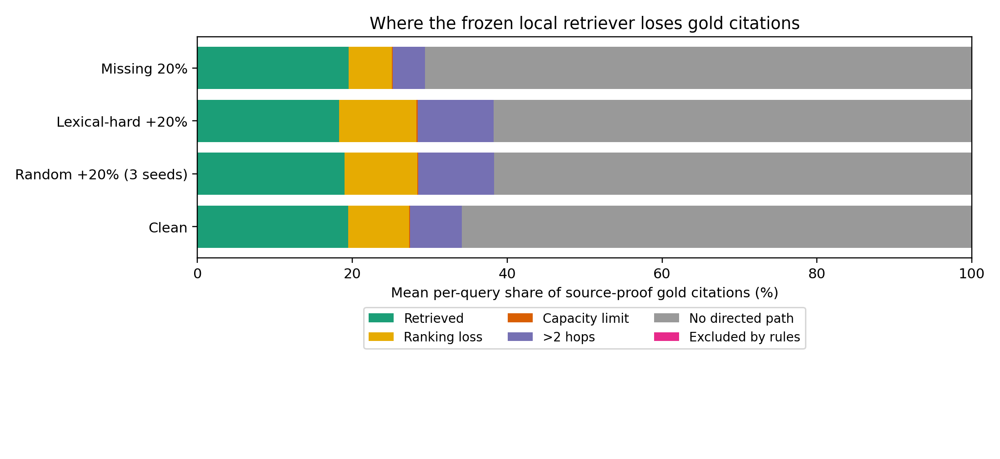

# 기존 검색기의 작동 원리와 실패 원인

분석일: 2026-11-23. 대상은 이번 연구의 `scoped-v1` **지역 그래프 검색기**이다. 시험 질문 567개/25개 원문 블록을 그대로 사용했다. 기존 모델·설정·결과는 변경하지 않았다. 이번 추가 비교는 [사후 진단 설계](RETRIEVER_DIAGNOSTIC_PROTOCOL.md)에 따라 수행했으며 새 검색기의 확정적 성능 검증이나 일반 GraphRAG 전체에 대한 평가가 아니다.

## 핵심 결론

낮은 회수율의 주된 병목은 **필요한 근거가 검색 후보에 들어오지 못하는 것**이다. 그다음 병목은 **후보 안의 근거를 같은 TF-IDF 점수로 낮게 정렬하는 것**이다. 여기에 이전 실험에서 정한 증명 관계 가림과 경계 종단 처리가 큰 영향을 준다.

정상 그래프에서 정답 근거의 평균 72.56%는 2단계 후보 밖에 있었고, 7.83%는 후보 안에 있었으나 순위 때문에 놓쳤다. 따라서 낮은 수치를 잘못된 간선 탓으로만 해석할 수 없다. 이번 측정은 특정 원문 증명의 직접 인용 회수율이며 답변 정확도나 수학적 추론 실패율과는 다르다.

## 1. 기존 검색기가 실제로 하는 일



질문과 문서는 자연어 임베딩이 아니라 형식적 수식의 기호 unigram/bigram으로 표현한다. 변수 이름은 형식에 따라 정규화한다. 배경 문서에서 만든 TF-IDF 표현은 2,314차원이며 질문과 문서의 코사인 유사도를 사용한다. 원문에서 질문보다 앞선 명제만 허용하고, 질문과 동일한 정규화 서명의 명제는 제외한다.

간선 `T → L`의 뜻은 'T의 지정된 증명이 L을 실제로 인용했다'이다. 그래프 탐색은 이 방향만 따른다. 관계를 거꾸로 따라가거나, 유사한 수식을 논리적으로 치환하거나, 가정이 충분한지 검증하는 추론 단계는 없다. 필수 가정은 문서에 보존하지만 TF-IDF에서는 기호 텍스트로 처리한다.

**그래프는 후보 집합만 바꾸며, 최종 점수 자체를 바꾸지 않는다.** 경로의 신뢰도나 논리적 필요성으로 순위를 매기는 검색기는 아니다. 이 때문에 다음 성질을 실제 실행에서 확인했다.

- 처음 고른 시드 4개가 최종 결과의 상위 4개에 그대로 남는다. 간선 삭제로 이 시드들을 밀어낼 수 없다.
- 시드를 20개로 잡고 Top20을 반환하면 결과는 전역 TF-IDF Top20과 정확히 같다. 이 설정에서는 그래프 확장이 반환 순위에 영향을 주지 않는다.
- 간선 삭제는 현재 도달 집합의 일부를 없앨 수만 있다. 원래 도달하지 못한 근거를 새로 가져올 수 없다.

학습 모델은 이 검색기와 별도다. Gradient boosting은 '어떤 간선을 삭제하면 Recall이 바뀌는가'를 예측한다. TF-IDF 표현이나 검색 순위 점수를 새로 학습하지 않는다.

원리의 구현 위치는 [질문 점수·시드·후보 구성](owe/experiment.py), [탐색·정렬·삭제](owe/retrieval.py), [명제 표현·가림 규칙](owe/prepare.py)에서 확인할 수 있다.

## 2. 정상 그래프에서 어디서 잃는가

아래 비율은 **각 질문의 전체 정답 인용 수를 분모로 계산한 후 질문 간 평균한 값**이다. 질문 실패 비율이나 전체 인용을 한데 모아 계산한 비율이 아니다. 정상 그래프에서도 누락이 생기는 이유를 보려는 분해다.

| 단계 | 전체 정답 근거에 대한 평균 비중 |
|---|---:|
| 최종 Top20에 회수됨 | 19.49% |
| 2단계 후보 안에 있지만 순위 때문에 누락됨 | 7.83% |
| 후보 안의 정답만으로도 20개를 넘어서 생기는 용량상 누락 | 0.12% |
| 현재 방향으로 경로가 있지만 3단계 이상 필요함 | 6.68% |
| 현재 시드와 공개된 방향 그래프에서 경로가 없음 | 65.88% |
| 원문 순서·동일 서명 제외 규칙으로 정답 자체가 배제됨 | 0.00% |

2단계 후보에 들어오는 정답은 평균 **27.44%**다. 이 후보를 고정하면 정답을 아는 완벽한 재정렬도 K=20에서 최대 **27.32%**까지 회수한다. 현재 19.49%에서 순위만 고쳐 회복 가능한 차이가 7.83pp이고, 더 큰 문제는 후보 밖의 72.56%다.

'경로 없음'은 수학적으로 무관하다는 뜻이 아니다. 현재 시드·공개 간선·방향·경계 설정에서 도달할 수 없다는 뜻이다. 원문 인용은 모두 검색 허용 대상이어서, 동일 서명 제외가 정답을 직접 제거한 사례는 없었다.

전체 정답 집합을 가정하면 K=20만으로도 평균 6.02pp의 필연적 누락이 생긴다. 위 표의 0.12%는 이미 후보에 들어온 정답 안에서 용량만으로 추가 누락되는 부분이다. 후보 밖의 누락과 중복 계산하지 않도록 이렇게 분해했다. 시험 질문 87개는 정답 인용이 20개보다 많아 완전 회수가 불가능하다.



## 3. 후보 확보를 막는 두 가지 구조적 문제

### 3.1 확장할 수 없는 시드가 많이 선택된다

4개씩 고른 시드 2,268개를 분류했다.

| 시드 유형 | 선택 횟수 | 비중 |
|---|---:|---:|
| 검증·시험 증명이어서 출발 관계를 숨긴 명제 | 1,108 | 48.85% |
| 실제로 확장 가능한 명제 | 846 | 37.30% |
| 범위 경계의 종단 근거 | 279 | 12.30% |
| 그 밖의 원래 종단 명제 | 35 | 1.54% |

**188/567개 질문(33.16%)은 시드 4개에서 탐색할 관계가 전혀 없었다.** 그중 97개는 네 시드가 모두 증명 가림 대상이었다. 가려진 시드로 선택된 명제는 원문에 실제 증명 사용 관계가 있었음도 별도로 확인했다. 즉 원래 수학 지식의 관계가 없는 것이 아니라, 이번 평가에서 사용할 수 없게 만든 경우가 많았다.

이 부분은 제가 이전 실험에 적용한 **평가·데이터 구성 선택의 영향**이다. 질문의 정답 증명을 직접 읽지 않게 하는 규칙은 필요하지만, 검증·시험 질문군 전체의 출발 관계를 가린 뒤 같은 질문군의 비슷한 명제를 시드로 선택하면 그래프 탐색이 자주 막힌다. 경계 노드를 모두 종단으로 두는 선택도 같은 현상을 만든다. 따라서 이 결과에서 일반적인 그래프 검색 알고리즘의 약점과 이번 가림·경계 설계의 영향을 분리해야 한다.

### 3.2 고정된 시드 4개가 접근 범위를 제한한다

현재 방향의 그래프를 끝까지 따라가도 정답 후보 포함률은 평균 **34.12%**다. 단순히 2단계가 짧다는 문제만으로 설명되지 않는다. 출발점과 공개된 연결 자체가 정답 근거 쪽으로 이어지지 않는 경우가 많다.

참고로 시험 정답의 질문별 평균 비중은 핵심 명제 42.53%, 경계 근거 57.47%였다. 전체 정답 대비 실제 회수분은 각각 14.66%, 4.83%였다. 경계 근거 중 상당 부분이 후보에 도달하지 못했다. 이는 시험 질문에 동일 가중을 준 계산이며, 기존 보고서의 전체 데이터 인용 수 기준 경계 비중 69.50%와 계산 대상·가중치가 다르다.

## 4. 탐색을 늘리면 왜 오히려 나빠지는가

정상 그래프·같은 567개 질문에서 탐색 범위만 바꾸어 진단했다. 모델이나 순위 점수는 바꾸지 않았다.

| 시드4개에서 탐색 | 정답 후보 포함률 | 실제 Recall@20 | 평균 후보 수 | 평균 확장 간선 항목 수 |
|---|---:|---:|---:|---:|
| 0단계: 시드만 | 12.61% | 12.61% | 4.00 | 0.00 |
| 1단계 | 23.87% | 20.85% | 17.47 | 14.97 |
| 기존 2단계 | 27.44% | 19.49% | 33.73 | 36.47 |
| 3단계 | 29.34% | 18.48% | 52.37 | 63.77 |
| 4단계 | 31.00% | 17.94% | 71.77 | 95.58 |
| 현재 방향으로 전체 도달 | 34.12% | 17.11% | 130.69 | 219.08 |
| 공개 관계를 양방향으로 2단계 | 34.75% | 16.96% | 305.66 | 559.80 |

탐색을 넓히면 정답 후보는 실제로 늘어난다. 그러나 **후보에 새로 들어온 정답을 높은 순위에 올리는 능력이 부족해 최종 회수율은 떨어진다.** 수식이 비슷하지만 원문 증명에서 인용하지 않은 명제가 상위20개를 차지한다. 경로를 더 많이 찾는 것과 필요한 근거를 상위에 유지하는 것은 다른 문제다.

양방향 탐색에서도 미래 원문 명제와 동일 질문 서명을 계속 제외했다. 이 비교는 탐색량이 크게 달라서 같은 계산 예산 비교가 아니다. 1단계가 기존2단계보다 높은 결과도 사후 진단이며, 시험에서 최적 깊이를 골라 새 성능으로 주장하지 않는다.

시드 수만 바꾼 결과도 보존했다.

| 시드 수, 모두2단계 탐색 | 정답 후보 포함률 | 실제 Recall@20 | 평균 후보 수 |
|---|---:|---:|---:|
| 1개 | 12.55% | 11.00% | 7.83 |
| 기존4개 | 27.44% | 19.49% | 33.73 |
| 8개 | 36.48% | 22.16% | 61.62 |
| 16개 | 47.34% | 23.84% | 109.81 |
| 20개 | 51.05% | 23.38% | 132.81 |

시드를 늘리면 어휘 검색의 상위 문서를 더 많이 보존한다. 특히 시드20개·Top20은 전역 어휘 검색과 결과가 완전히 같다. 따라서 이 표를 그래프 추론 능력이 좋아졌다는 근거로 쓰면 안 된다. 최적 시드 수는 새 검증 절차에서 정해야 한다.

## 5. 실제 수학 사례

### 5.1 쾨니히스베르크 질문: 주제는 맞게 찾았지만 확장이 막혔다

시험 질의 `konigsberg`의 시드는 다음이었다.

| 시드 | 질문 유사도 | 탐색 가능한 출발 관계 수 |
|---|---:|---:|
| `konigsbergumgr` | 0.9789 | 0 |
| `konigsbergiedg` | 0.9737 | 0 |
| `konigsbergvtx` | 0.9698 | 0 |
| `konigsberglem1` | 0.9651 | 0 |

비슷한 주제의 명제를 찾았지만 네 명제의 출발 증명 관계가 모두 가려져 있었다. 검색은 사실상 시드4개에서 끝났고, 원문 인용 정답25개 중 1개만 회수해 Recall이 **4%**였다. 또 다른 정답 `konigsberglem5`는 전역 어휘 순위9위로 충분히 가까웠지만 그래프 후보에 들어오지 않았다.

이 사례는 주제 유사도와 시드의 확장 가능성이 다르다는 것을 보여준다. 모든 실패를 '질문의 의미를 잘못 파악했다'로 설명할 수 없다.

### 5.2 오일러 경로 조건 질문: 정답이 후보에 있어도 순위에서 모두 밀렸다

`eulerpathpr`의 지정된 원문 증명은 직접 인용26개를 사용했다. 시드4개는 차수·홀수 차수·그래프 관련 명제였고 실제 확장 관계도 있었다. 2단계 안에서 정답9개를 찾았지만, **그9개가 모두 Top20 밖으로 밀려 최종 정답 회수는0개**였다.

예를 들어 실제 원문 증명에서 사용한 `a1i`, `syl`, `eqid` 등의 일반 논리·등식 규칙은 질문 수식과 겉모양이 크게 다르다. `syl`은 전역 TF-IDF 순위5,538위였지만 그래프에서는 한 단계로 도달했다. 그래프가 가져오는 데 성공한 이 근거를 같은 TF-IDF 점수로 다시 낮게 정렬한 것이다.

이 사례에서는 후보 내 완벽한 재정렬이면 9/26, 약34.62%를 회수하지만 실제로는0%였다. '수식이 비슷한 명제'와 '그 수식의 특정 증명이 사용한 근거'가 다르기 때문에 생기는 문제다.

### 5.3 정답 정의 자체의 영향

현재 정답에는 특정 원문 증명의 일반 논리 규칙과 등식 보조정리도 포함된다. 반면 의미상 유용한 다른 정리나 대체 증명의 근거는 정답 인용으로 인정되지 않을 수 있다. 따라서 낮은 회수율은 **이 원문 증명의 인용을 잘 회수하지 못했다**는 뜻이며, 수학적으로 도움이 되는 자료를 전혀 찾지 못했거나 답변이 틀렸음을 입증하지는 않는다.

## 6. 잘못된 간선은 어떻게 영향을 주었는가

| 조건 | 2단계 정답 후보 포함률 | 후보 내 순위 손실 | 실제 Recall@20 |
|---|---:|---:|---:|
| 정상 | 27.44% | 7.83% | 19.49% |
| 무작위 관계20% 추가, 3시드 평균 | 28.53% | 9.37% | 19.01% |
| 어휘상 유사한 거짓 귀속20% 추가 | 28.46% | 9.98% | 18.31% |
| 실제 관계20% 누락 | 25.19% | 5.59% | 19.50% |

오류 추가는 일부 정답으로 가는 우회 연결도 만들어 후보 포함률을 늘렸다. 동시에 원문 인용이 아닌 문서도 경쟁하게 만들어 순위 손실이 더 커졌다. 결과적으로 회수율이 떨어졌다. 실제 관계를 제거하면 후보 포함률은 줄지만 순위 경쟁도 줄어 전체 점수는 반드시 단조롭게 나빠지지는 않았다.

이 결과는 정확한 관계와 질문별 검색 효용을 분리해야 한다는 기존 연구 문제의식과 맞는다. 다만 그래프가 정상일 때도 회수율이19.49%였으므로, 전체 저성능의 원인을 거짓 간선만으로 돌릴 수는 없다.

## 7. 간선 삭제 학습의 개선 폭이 작은 이유

정상 그래프의 **305/567개 질문(53.79%)은 도달 후보가20개 이하**였다. 현재 점수·시드가 고정되어 있으면 이 질문들에서 간선 삭제로 회수율을 높일 수 없다.

이유는 간단하다. 삭제 뒤 도달 집합은 삭제 전 집합의 부분집합이다. 원래 후보가20개 이하라 모두 반환하고 있었다면, 삭제는 회수된 정답을 유지하거나 잃게 할 뿐 새 정답을 추가하지 못한다. 단일 삭제뿐 아니라 이 조건을 지키는 다중 삭제에도 같은 논리가 적용된다.

정상 그래프에서 후보 내 완벽한 재정렬의 상한은27.32%였지만, 최대48개 후보 중 최선의 단일 삭제를 아는 효용 오라클의 실제 회수율은20.78%였다. 재정렬 문제의 일부만 간선 하나 삭제로 해결할 수 있는 것이다. 학습 정책은 이 제한된 행동 공간에서 개선을 시도했다.

따라서 학습 이득이 작다는 결과를 모델 종류의 문제로만 설명하기 어렵다. 먼저 후보를 확보하고, 그 후보의 수학적·증명상 역할을 반영해 순위를 정하는 문제를 해결해야 간선 판단의 추가 가치도 제대로 평가할 수 있다.

## 8. 다음 설계에서 우선 검증할 항목

1. **배경 지식과 시험 질의의 가림 방식 재검토.** 정답 증명 직접 접근은 막되, 주변의 유용한 배경 정리까지 대량으로 탐색 불가능하게 만들지 않도록 별도 배경 코퍼스와 질의 집합의 경계를 설계한다. 시험 증명을 단순히 공개하는 방식으로 해결하지 않는다.
2. **후보 확보와 순위 결정의 분리 평가.** 고정4개 시드·빈 이웃·부족한 후보를 보완하는 전략을 검증 자료에서 정하고, 후보 포함률과 최종 Recall을 함께 본다. 노드 수나 hop만 늘리는 방법은 이번 진단에서 충분하지 않았다.
3. **증명상 필요성을 반영하는 순위 모델.** 기호 유사도뿐 아니라 가정, 정리의 역할, 일반 논리 보조정리와 분야 정리의 차이를 다룰 방법을 검토한다. 특정 모델이 좋아질 것이라고 미리 가정하지 않는다.
4. **정답 근거 수준을 연구 목적에 맞게 구분.** 원문 인용 재현, 수학적 주장에 충분한 근거, 실제 답변·증명 검증 성공률을 같은 지표로 취급하지 않는다. 어려운 논리 규칙을 사후 제거해 성능을 높였다고 주장하지 않는다.

이 네 항목을 새 설계에서 검증한 뒤 간선 삭제의 추가 효과를 비교하는 것이 타당하다. 이번 분석은 원인 진단을 완료한 것이며 위 개선 시스템을 구현·검증한 결과는 아니다.

## 재현·검사

```powershell
python -m owe.diagnose_retriever
python -m owe.audit_retriever_diagnosis
```

원시 분해표는 [stage_decomposition.csv](runs/retriever_diagnostic_v1/stage_decomposition.csv), 블록 구간은 [stage_summary.csv](runs/retriever_diagnostic_v1/stage_summary.csv), 추가 탐색 비교는 [mechanism_summary.csv](runs/retriever_diagnostic_v1/mechanism_summary.csv), 개별 수학 사례는 [euler_and_failure_examples.json](runs/retriever_diagnostic_v1/euler_and_failure_examples.json)에 있다.

원래7개 조건의 기준 검색 결과3,969개를 재계산해 기존 저장 결과와 일치시켰다. 모든 누락 분해의 합이1임을 확인했고, 별도 SciPy 최단경로 구현으로40개 질문-조건 사례를 교차 검사했다. 시드·출력 불변조건과 숨긴 시드의 실제 원문 관계 존재도 확인했다. [검사 기록](runs/retriever_diagnostic_v1/diagnostic_checks.json)을 보존했다.

기존 코드·설정·모델·원시 결과와 기존 ZIP 묶음은 변경하지 않았다. 이번 추가 분석 파일은 `runs/retriever_diagnostic_v1/`에 별도로 저장했다.
